# SciFlow

**A research workbench that takes a topic to a submittable manuscript — and refuses to hand back anything that fails inspection: a deterministic quality gate, citations that resolve to a real paper, and a verification suite you can rerun yourself.**

[](https://github.com/Morningstar202604/sciflow/actions/workflows/ci.yml)
[](LICENSE)
[-339933.svg)](package.json)
[](package.json)
[](CHANGELOG.md)

**English** · [简体中文](README.zh-CN.md)

---

## What actually makes it different

|  |  |
| --- | --- |
| **One pipeline to submission** | Topic validation → literature survey → outline gate → section drafting → quality gate → polish → citation formatting → journal submission tracking. Checkpoints after every step, resumes after a restart |
| **A quality gate, not a vibe check** | Seven dimensions scored by deterministic rules with a stable fingerprint — same text, same score, reproducible. Below threshold triggers targeted revision, up to three rounds |
| **Citations that resolve to a real paper** | Every `[n]` anchor traces to a citation row, then to a reference row. Ghost anchors, orphan entries, broken numbering and duplicate DOIs are flagged by number. Empty reference pool ⇒ drafting prompts forbid citation markers outright |
| **The evidence chain is visible** | The writing view renders the argument's provenance — research question, literature evidence, in-text anchors, citation records — and marks exactly where it breaks. 22 references with zero anchors is reported as two broken links, not a green check |
| **Guarded autonomy** | Tool approval pauses side-effecting actions with a readable reason; tool-call repetition guard stops loop idling; model fallback chain survives a dead primary endpoint; every LLM call is logged with cost |
| **Claims you can verify** | The verification table below is rerunnable on your machine. If a number is wrong, that's a bug — file it |

## Screenshots

All screenshots are captured from the running application against a seeded demo database.

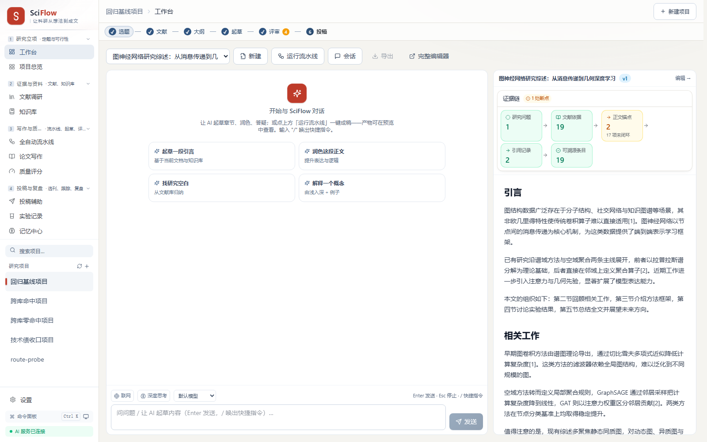

| Project cockpit | Fully automatic pipeline |
| --- | --- |
| 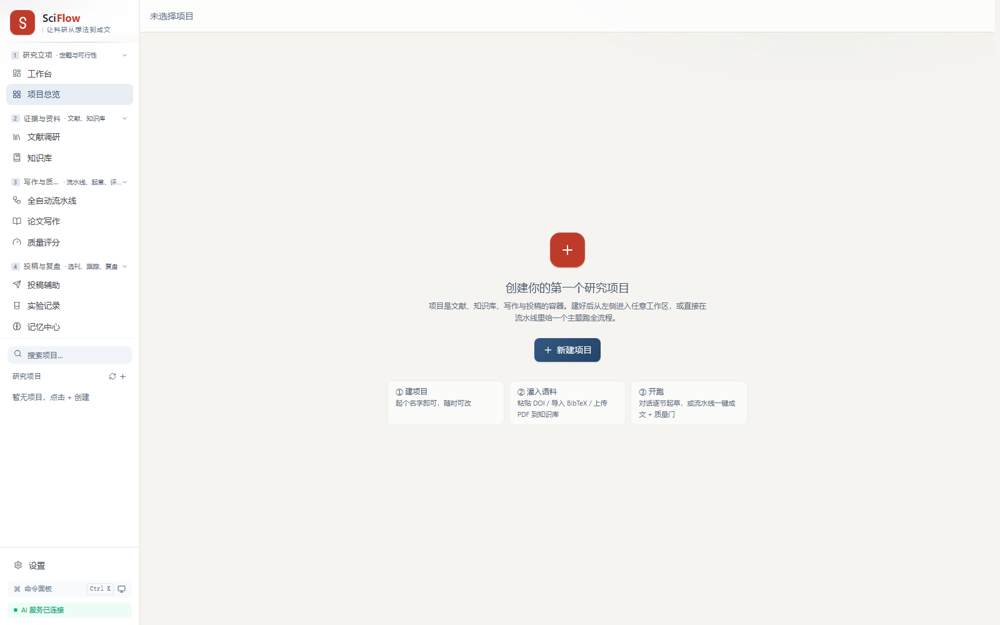 | 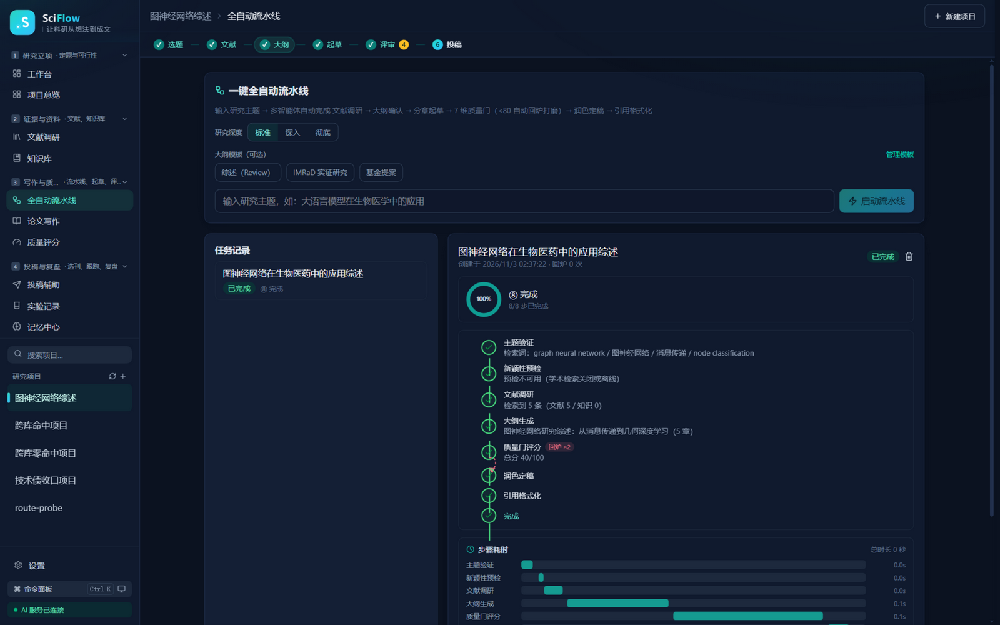 |

| Writing · outline, editor and preview | Quality · seven-dimension scoring |
| --- | --- |
| 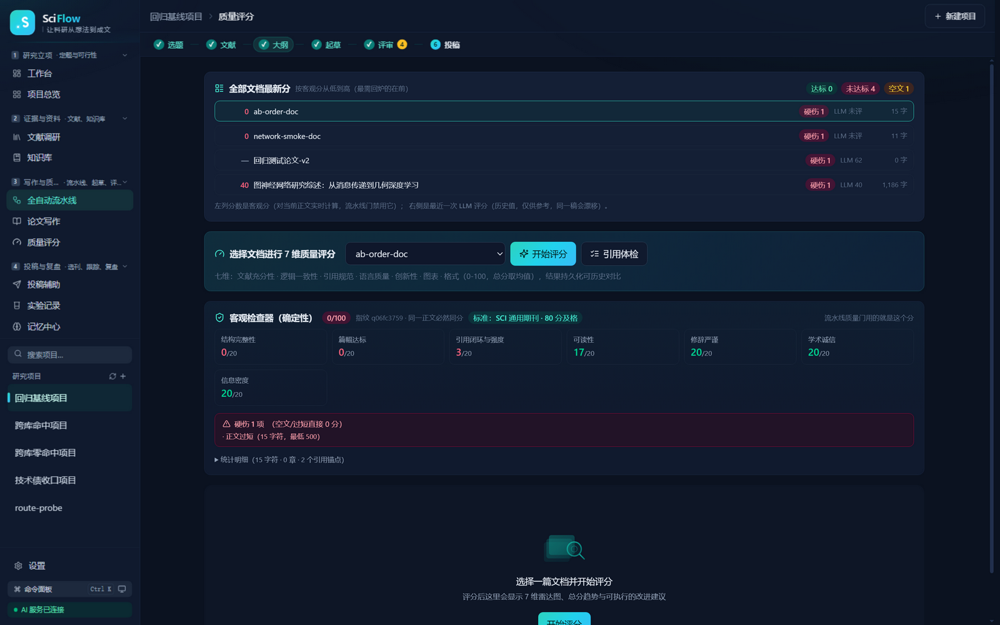 | 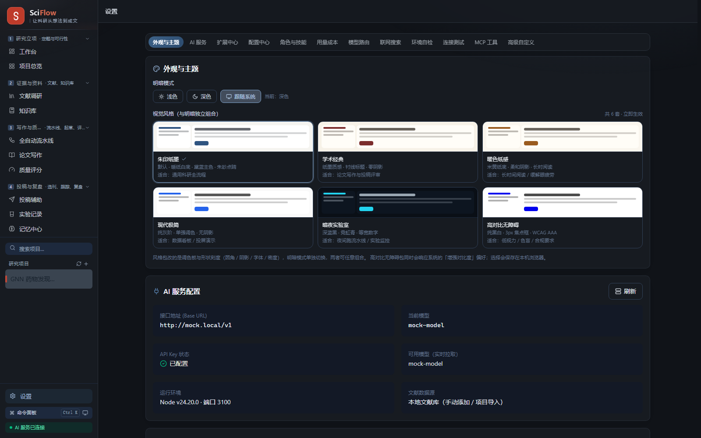 |

| Literature screening | Knowledge base · grounded Q&A |
| --- | --- |
| 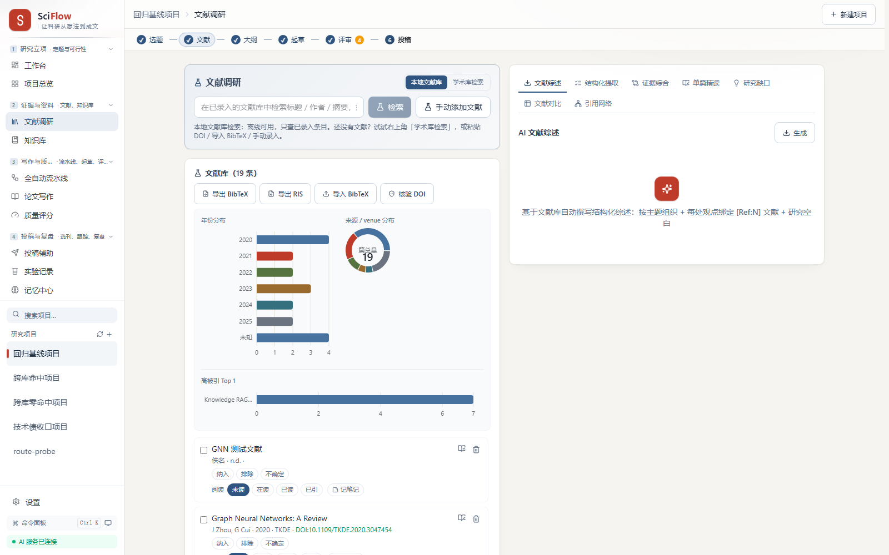 | 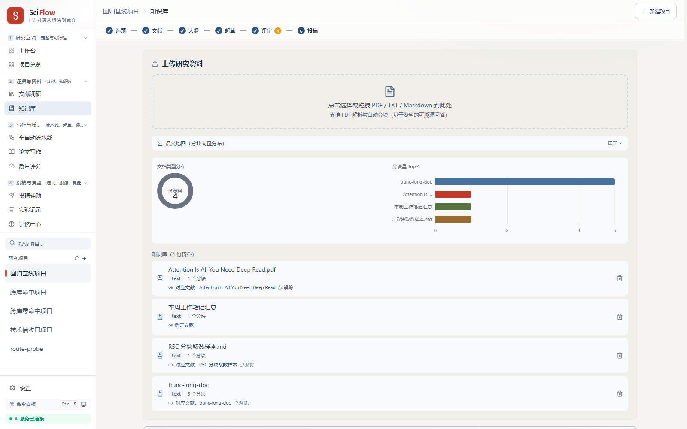 |

| Submission · journals, cover letter, tracking | Experiment log and sandbox |
| --- | --- |
| 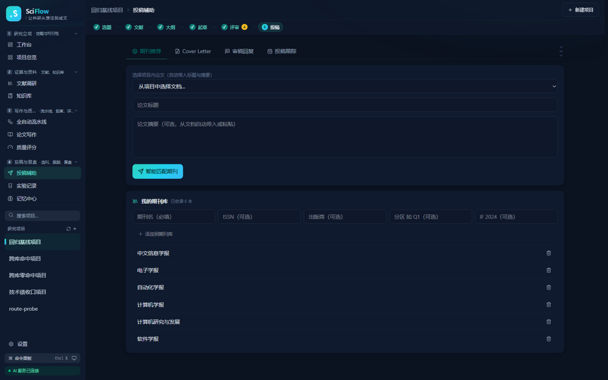 | 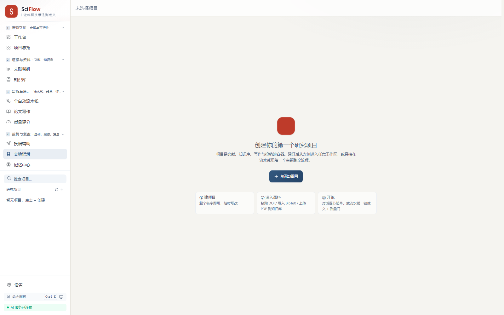 |

| Memory center | Settings · models, extensions, hotkeys |
| --- | --- |
| 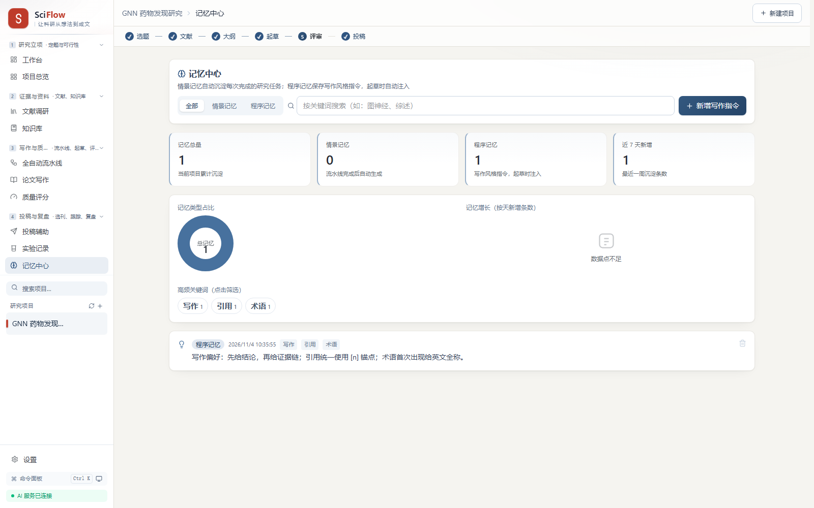 | 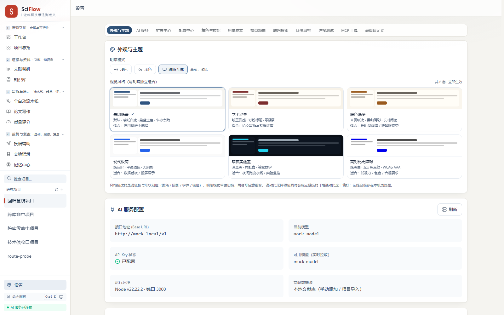 |

## Core capabilities

- **Research pipeline (LangGraph).** Human outline checkpoint, recursive literature survey (depth 1-3), outline with contrarian variants, parallel section drafting, quality gate with automatic revision, polish, citation formatting.
- **Deterministic quality gate.** Seven rule-scored dimensions (structure, length, citation closure and strength, readability, rhetoric, integrity, information density). Five selectable standards from draft iteration to top-journal submission. Below 90% of required length is a hard cap - no decorative points can rescue it.
- **Citation integrity.** Anchor to citation to reference three-level traceability; seven audit classes. The reference pool cannot be lied to.
- **Agent harness.** Model-maintained task list, context compaction, mentions, tool approval, tool-call repetition guard (AGENT_TOOL_REPEAT_LIMIT), model fallback chain (AI_MODEL_FALLBACK).
- **Retrieval.** sqlite-vec + FTS5 trigram, reciprocal-rank fusion, MMR dedup; embeddings via local GGUF or your provider; academic search against OpenAlex, Crossref, arXiv with TTL caching.
- **Model freedom.** OpenAI-compatible / Anthropic / Gemini protocols; fast and strong tiers; a local Ollama or GGUF model behaves the same as a cloud endpoint.
- **MCP in both directions.** Expose SciFlow tools to any MCP client; attach external MCP servers. Handshake verified by scripts/mcp-handshake.mjs.
- **Headless.** sciflow run --topic "..." --auto --out ./paper/ produces a manuscript without opening a window.

## Quick start

Requires Node ≥ 20 (CI uses 22) and pnpm 11.7.0.

```bash
git clone https://gitcode.com/badhope/sciflow.git
cd sciflow
pnpm install
pnpm doctor
cp apps/server/.env.example apps/server/.env
# set AI_BASE_URL, AI_API_KEY and AI_MODEL in apps/server/.env
pnpm build
pnpm start
```

Open `http://localhost:3000`, or run the web dev server separately with `pnpm dev:web`.

### Try it without an API key

The deterministic mock gateway exercises the entire pipeline locally:

```bash
AI_MOCK=1 DATABASE_PATH=/tmp/sciflow_demo.db PORT=3000 \
  node apps/server/dist/apps/server/src/main.js
node scripts/seed-demo.mjs
```

### Docker

```bash
docker compose up --build                              # development
docker compose -f docker-compose.prod.yml up --build    # production
```

### Desktop

```bash
pnpm build && pnpm icons
pnpm desktop:dev     # development
pnpm desktop:dist    # installer in apps/desktop/release/
```

## Configuration

Everything lives in `apps/server/.env`. The settings page covers the same options with a connection test and model discovery, so the file is optional for interactive use.

| Variable | Purpose |
| --- | --- |
| `AI_BASE_URL` · `AI_API_KEY` · `AI_MODEL` | Primary model endpoint |
| `AI_PROTOCOL` | `openai-compatible` (default), `anthropic`, or `gemini` |
| `AI_MODEL_FAST` · `AI_MODEL_STRONG` | Tier routing for cheap and heavy steps |
| `AI_RPM_CAP` | Requests-per-minute ceiling |
| `DATABASE_PATH` | SQLite file location |
| `AUTH_MODE` | `none` for local use, `jwt` for shared deployments |
| `ALLOW_PRIVATE_OUTBOUND` | Permit loopback and RFC1918 targets for local model servers |

See [`docs/CONFIGURATION.md`](docs/CONFIGURATION.md) for scenario-based guidance.

## Verification

Every number below comes from a command that was actually executed on the current tree.

| Check | Command | Result |
| --- | --- | --- |
| Server unit and integration | `pnpm --filter @sciflow/server test` | 52 files, 404 tests |
| Web unit | `pnpm --filter @sciflow/web test` | 25 files, 175 tests |
| Desktop unit | `pnpm --filter @sciflow/desktop test` | 1 file, 5 tests |
| Types / Lint / Build | `pnpm -r typecheck` + `pnpm lint` + `pnpm -r build` | clean / 0 errors / success |
| Black-box regression | `python scripts/full_regression.py` | 238 passed, 0 failed, 0 known-gaps |
| Route probe | `python scripts/route_probe.py` | 96 routes, 0 failures |
| Acceptance matrix | `python scripts/final_acceptance.py` | 23 of 23 |
| Config monitor | `node scripts/monitor_config_center.mjs` | 25 of 25 |
| MCP protocol handshake | `node scripts/mcp-handshake.mjs` | 5 of 5 steps |

## Architecture

```
apps/server      NestJS 11 · Drizzle ORM · better-sqlite3 (WAL) · Vercel AI SDK · LangGraph · MCP SDK
apps/web         React 19 · Vite 6 · Tailwind v4 · TanStack Query/Table · Recharts · sigma.js · CodeMirror 6
apps/desktop     Electron 41 · embedded server · electron-builder
packages/core    Shared domain logic: quality audit, citation audit, address policy, pipeline steps
packages/ai      Transport, model catalog, guarded outbound fetch, mock gateway
packages/db      Schema, migrations, secret encryption
packages/retrieval  Vector and full-text retrieval, MMR, embeddings
```

The data chain is `Project → Document (versioned) → Citation → Reference`, with `PipelineTask`, `AgentExecution`, `ReflexionLog`, `MemoryLog` and `LlmCallLog` recording state, traces, revision rounds, memory and cost.

Deeper detail lives in [`ARCHITECTURE.md`](ARCHITECTURE.md).

## Documentation

| Document | Contents |
| --- | --- |
| [`ARCHITECTURE.md`](ARCHITECTURE.md) | Module boundaries, data flow, contracts and decision records |
| [`docs/CONFIGURATION.md`](docs/CONFIGURATION.md) | Model, search, auth and CLI configuration by scenario |
| [`docs/OPERATIONS.md`](docs/OPERATIONS.md) | Health probes, backup and restore, failure modes |
| [`docs/deployment.md`](docs/deployment.md) | Docker, desktop packaging and production notes |
| [`docs/development.md`](docs/development.md) | Local development workflow |
| [`docs/BRAND.md`](docs/BRAND.md) | Visual identity and design tokens |
| [`docs/product-roadmap.md`](docs/product-roadmap.md) | Capability matrix and planned work |
| [`CONTRIBUTING.md`](CONTRIBUTING.md) | Branching, commits, review and release flow |
| [`SECURITY.md`](SECURITY.md) | Threat model and disclosure policy |
| [`CHANGELOG.md`](CHANGELOG.md) | Release history |

## Project status

Current release: **1.11.0**. See [`CHANGELOG.md`](CHANGELOG.md) for the full history and [`docs/product-roadmap.md`](docs/product-roadmap.md) for what is next.

Known gaps: real-model end-to-end runs require your own API key; Docker and Playwright suites run in CI but not on every contributor machine; Windows installer builds locally need a C++ toolchain, or use the desktop-installer CI workflow (verified green). Honest-gap tracking lives in docs/ECOSYSTEM-AUDIT.md.

## License

MIT. See [`LICENSE`](LICENSE).
