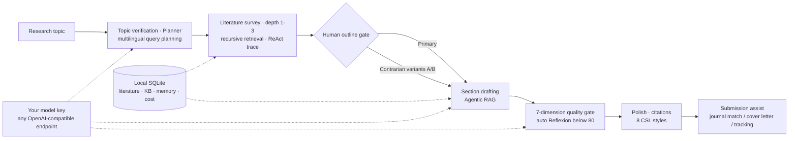

# SciFlow · Local-First AI Research Workbench

> **From a research topic to a submittable manuscript in one pipeline: literature survey → outline (with contrarian variants) → section-wise drafting → quality-gate rewriting → polishing → citations → submission assistance.**
> Your data, model keys, literature and memory never leave your machine — no cloud, no multi-tenancy, no lock-in.

[](https://github.com/Morningstar202604/sciflow/actions/workflows/ci.yml)
[](LICENSE)
[-339933.svg)](package.json)
[](package.json)
[](CHANGELOG.md)

> **🌐 Language / 语言：[English](README.en.md) · [中文](README.md)**

> **Repository mirrors (synced across 5 platforms)**
> [GitCode](https://gitcode.com/badhope/sciflow) · [Gitee](https://gitee.com/badhope/sciflow) · [GitHub · badhope](https://github.com/badhope/sciflow) · [GitHub · X33834](https://github.com/X33834/sciflow) · [GitHub · Morningstar202604](https://github.com/Morningstar202604/sciflow)
> The three GitHub mirrors run the same CI: lint · typecheck ×2 · vitest ×2 · build ×2 · full mock regression (178 checks) · promptfoo prompt-contract evals · Playwright smoke; GitCode and Gitee mirror the same release tree.

<!-- Architecture at a glance (Mermaid renders inline, no image assets needed) -->



## 🗞 Latest news

- **2026-10-24 · v1.0.0**: research-depth parameter (1–3 rounds of recursive retrieval), contrarian outline variants (anti-homogenization), experiment design assistant, per-step timing chart, headless CLI (`sciflow run`), MCP resources, deep health probe.
- **2026-10-23 · v0.11.0**: new "Ink Current" brand mark; research chat merged into the workspace (single chat entry with local multi-session, slash commands, follow-up suggestions).
- **2026-10-23 · v0.10.0**: unified chat kernel / global hotkey registry / project stage bar / draggable split panes.
- **2026-10-23 · v0.9.0**: 35 findings fixed from a full-dimension audit (two Criticals: PATCH whitelist, CSL dedup) + brand/touch/contrast polish.

See [`CHANGELOG.md`](CHANGELOG.md) for the full history.

## 📸 Screenshots

> All screenshots are taken from the real running app (1600×1000, local mock gateway, demo data seeded by `scripts/seed-demo.mjs`) — no collage or retouching.


| Pipeline · depth selector + step timing | Quality · 7-dimension radar |
| --- | --- |
|  |  |

| Writing · outline + split preview | Literature · screening & reading state |
| --- | --- |
|  |  |

| Knowledge base · grounded Q&A | Dashboard · end-to-end todos |
| --- | --- |
|  |  |

| Experiments · sandbox + design assistant | Submission · journals / cover letter / tracking |
| --- | --- |
|  |  |

| Memory center · episodic / procedural | Settings · hotkeys & usage cost |
| --- | --- |
|  |  |

**25-second product tour**: [`docs/media/demo.mp4`](docs/media/demo.mp4) (recorded with Playwright against the real UI).

## ✨ Features

### Writing & finalizing
- **Outline-first**: AI generates a research plan and section outline; edit / preview / split view; **contrarian variants** challenge the mainstream narrative so your draft is not yet another template paper.
- **Section-wise drafting + Agentic RAG**: each section searches the local knowledge base while writing; `[n]` anchors map 1:1 to the reference list.
- **Academic polishing**: three-part polish (original + polished + rationale), CN↔EN translation, paraphrasing; tail blocks (references / figures) are protected from rewriting.
- **Version history + diff**: named snapshots, LCS text diff per version.
- **One-click export**: Markdown / Word (.docx).

### Citations & literature
- **8 citation styles**: APA / IEEE / Vancouver / **GB/T 7714** / Nature / Chicago / Springer / ACS, re-rendered in place.
- **Anchor-based renumbering**: numeric anchors keep insertion order; author-year styles get a/b suffixes by first appearance.
- **BibTeX / RIS import-export**, fingerprint dedup, reading-status state machine.
- **PRISMA screening + coding matrix**, force-directed citation network with community coloring.

### Knowledge base RAG (NotebookLM-style)
- Local **sqlite-vec ANN + FTS5 trigram** hybrid retrieval (graceful FTS fallback without an embedding model); knowledge files bind to literature records; hits come with author/year source cards.

### Fully automatic pipeline
- **LangGraph orchestration + human confirmation**: topic verify → literature survey (research depth 1–3, recursive retrieval) → outline gate (primary + 2 contrarian variants) → parallel section drafting → **7-dimension quality gate** (auto Reflexion ≤3 rounds) → polish → citation formatting.
- **Checkpoint resume** after service restarts; **per-step timing chart**.
- **Model routing**: fast / strong tiers.

### Experiments & memory
- **Experiment design assistant**: research question → structured design (variables, control groups, sample-size/power hints, procedure, analysis plan, validity risks), persisted and reviewable.
- **Experiment sandbox**: isolated local Python execution with timeouts and output caps.
- **Memory center**: episodic + procedural memory injected into drafting.

### Experience details
- **⌘K command palette** (registry-based fuzzy matching), global hotkey registry + cheat sheet in Settings, unified chat kernel with follow-ups and slash commands, MCP tools **and resources**, **headless CLI** (`sciflow run --topic … --auto --out ./paper/`), **deep health probe** (`GET /api/health/deep`).
- Chinese-first error copy, mobile-aware layouts, AA-contrast brand system.

## 🆚 How SciFlow differs

| | SciFlow | Stanford STORM | Elicit | GPT-Researcher | NotebookLM |
| --- | --- | --- | --- | --- | --- |
| Deployment | **Local single-machine** (SQLite / Docker / desktop) | Cloud + OSS lib | Cloud SaaS | Self-host / cloud | Cloud |
| Models | **Bring your own key, any OpenAI-compatible endpoint (incl. Ollama)** | Fixed cloud models | Bundled | BYO key | Bundled |
| Privacy | **Everything local, zero third-party upload** | Cloud | Cloud | Depends | Cloud |
| Scope | Topic → literature → outline → drafting → quality gate → citations → **submission tracking** | Wiki-style report | Systematic review | Research report | Notebook Q&A |
| Citations | **8 CSL styles live re-render + citation audit + fingerprint dedup** | Footnotes | Extraction table | Citation list | Source chips |
| Anti-homogenization | **Contrarian outline variants + recursive research depth** | Multi-perspective QA | — | Recursive depth | — |
| Submission | **Journal matching / cover letter / reviewer reply / tracking** | — | — | — | — |
| CN academia | **GB/T 7714, CN journal library, Chinese-aware retrieval** | Weak | Weak | Weak | Weak |

> STORM/Elicit/NotebookLM are excellent cloud services; SciFlow does not fight their data moats. It fights the **"local-first + full-lifecycle loop + AI failure-mode governance"** battle: traceable citations, auto-rewrite quality gates, and hard cost budgets.

## 🏗 Tech stack

| Tier | Technologies |
| --- | --- |
| Server `apps/server` | NestJS 11 · TypeScript (strict) · Drizzle ORM · better-sqlite3 (WAL) · Vercel AI SDK (OpenAI-compatible) · LangGraph (orchestration / checkpoint / interrupt) · MCP official SDK · zod · helmet + pino · MSW in-process mock gateway |
| Web `apps/web` | React 19 · Vite 6 · TypeScript · Tailwind CSS v4 · TanStack Query/Table · Recharts · sigma.js + graphology · streamdown · CodeMirror 6 · react-markdown + KaTeX |
| Desktop `apps/desktop` | Electron 41 · embedded server · per-user SQLite · electron-builder · electron-updater (opt-in) |
| Engineering | pnpm workspace · vitest (server 108 / web 73) · Playwright smoke · promptfoo contract evals · GitHub Actions (3 jobs) · Python regression (178 checks) |

Data chain: `Project → Document (multi-version) → Citation → Reference (traceable)`; `PipelineTask / AgentExecution / ReflexionLog / MemoryLog / LlmCallLog` record pipeline state, agent traces, rewrite rounds, memory and token cost.

## 🚀 Quick start

Requires Node ≥ 20 (CI locks 22) and pnpm ≥ 9 (repo locks `pnpm@11.7.0`).

```bash
git clone <your-mirror-url> sciflow && cd sciflow
pnpm install
pnpm doctor                                   # environment self-check with fix hints
cp apps/server/.env.example apps/server/.env  # fill AI_BASE_URL / AI_API_KEY / AI_MODEL
pnpm --filter @sciflow/server build
node apps/server/dist/apps/server/src/main.js # backend :3000
pnpm --filter @sciflow/web dev                # frontend :5173 → http://localhost:5173
```

**No API key?** 30-second full-flow demo with the in-process mock gateway:

```bash
AI_MOCK=1 DATABASE_PATH=/tmp/sciflow_demo.db PORT=3000 node apps/server/dist/apps/server/src/main.js
node scripts/seed-demo.mjs && RUN_PIPELINE=1 node scripts/seed-demo.mjs
```

### Desktop app (optional)

```bash
pnpm install && pnpm build && pnpm icons
pnpm desktop:dev      # develop
pnpm desktop:dist     # package installer → apps/desktop/release/
```

See [`apps/desktop/README.md`](apps/desktop/README.md) and [`docs/BRAND.md`](docs/BRAND.md).

## ⌨️ Headless CLI

```bash
node apps/server/dist/apps/server/src/cli.js run \
  --topic "A survey of graph neural networks in biomedicine" \
  --auto --depth 2 --out ./paper/
# --auto      auto-confirm the outline (otherwise stops at the gate, exit 2)
# --depth 1-3 research depth (recursive retrieval rounds)
# --out dir   writes ./paper/<paper-title>.md on completion
```

Other commands: `health` / `project list` / `pipeline run|status` / `doc export` / `mcp serve` (stdio MCP server for Claude Desktop).

## 🔑 AI configuration

Any OpenAI-compatible endpoint works — fill `AI_BASE_URL` + `AI_API_KEY` + `AI_MODEL` in `apps/server/.env` (DeepSeek / Zhipu / Kimi / Ark / Qwen / Ollama local `http://localhost:11434/v1` …). `AI_MODEL_FAST` / `AI_MODEL_STRONG` route tiers; `AI_RPM_CAP` throttles; `AI_MOCK=1` enables the deterministic in-process mock gateway (no key, no network). Without a key, local features keep working and AI features show explicit configuration hints — **no fake data**.

## 🧪 Testing & regression

```bash
pnpm --filter @sciflow/server typecheck && pnpm --filter @sciflow/web typecheck
pnpm --filter @sciflow/server test          # vitest, 108 tests
pnpm --filter @sciflow/web test             # vitest, 73 tests
pnpm --filter @sciflow/server build && pnpm --filter @sciflow/web build
pnpm exec playwright test e2e/workspace-smoke.spec.ts
pnpm exec promptfoo eval -c evals/promptfooconfig.yaml

# Full blackbox regression (fresh DB + mock gateway): PASS 178 / FAIL 0
AI_MOCK=1 AI_RPM_CAP=120 DATABASE_PATH=/tmp/sciflow_regression.db PORT=3000 \
  node apps/server/dist/apps/server/src/main.js
SCIFLOW_BASE=http://localhost:3000 AI_MOCK=1 python3 scripts/full_regression.py
```

## 📚 Documentation

| Doc | Content |
| --- | --- |
| [`ARCHITECTURE.md`](ARCHITECTURE.md) | Architecture source of truth: dependency map, no-wheel-reinvention rules, contracts |
| [`docs/product-roadmap.md`](docs/product-roadmap.md) | Product roadmap: capability matrix, design principles, gaps |
| [`docs/CONFIGURATION.md`](docs/CONFIGURATION.md) | Scenario-based configuration guide (models, search, auth, CLI) |
| [`docs/index.html`](docs/index.html) | Project site (static page; GitHub Pages home) |
| [`CONTRIBUTING.md`](CONTRIBUTING.md) / [`SECURITY.md`](SECURITY.md) | Contribution flow / security disclosure |
| [`docs/OPERATIONS.md`](docs/OPERATIONS.md) | Ops handbook: health probes, backup/restore, failure modes |
| [`docs/QUALITY-BASELINE.md`](docs/QUALITY-BASELINE.md) | Quality baseline: coverage / complexity measured |
| [`docs/AUDIT-2026-10-23.md`](docs/AUDIT-2026-10-23.md) | Full-dimension audit report (35 findings, competitor matrix) |
| [`CHANGELOG.md`](CHANGELOG.md) | Release history |

## 🐳 Docker

```bash
docker compose up --build          # dev
docker compose -f docker-compose.prod.yml up --build   # production
```

## 📄 License

MIT — see [`LICENSE`](LICENSE).
