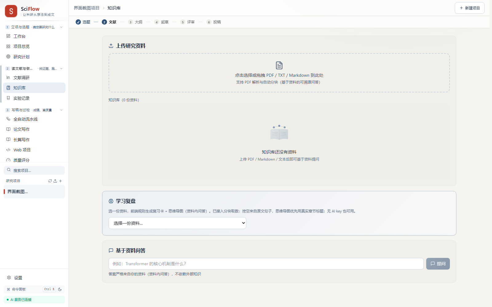
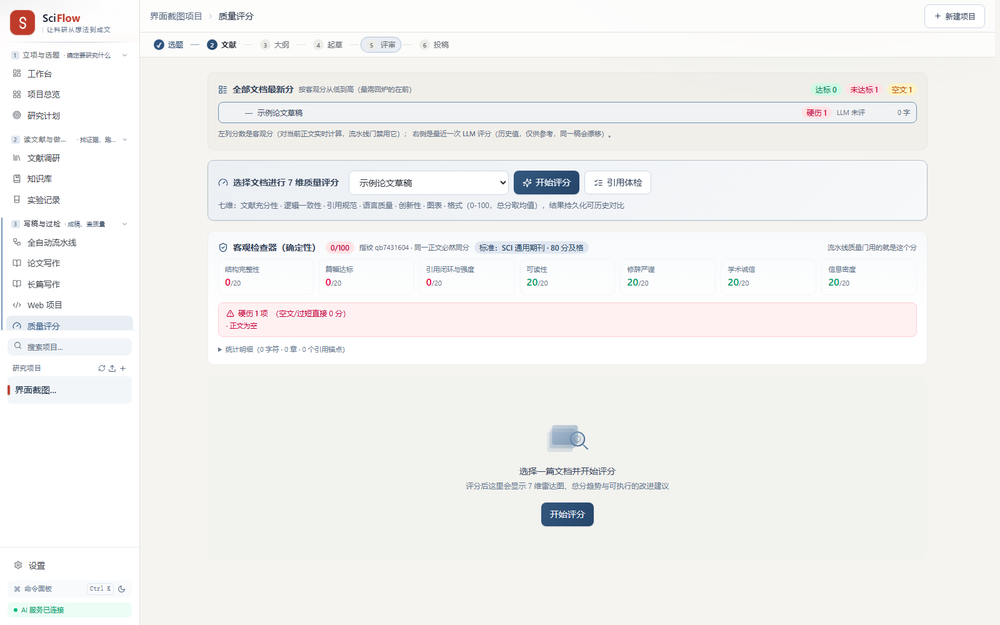
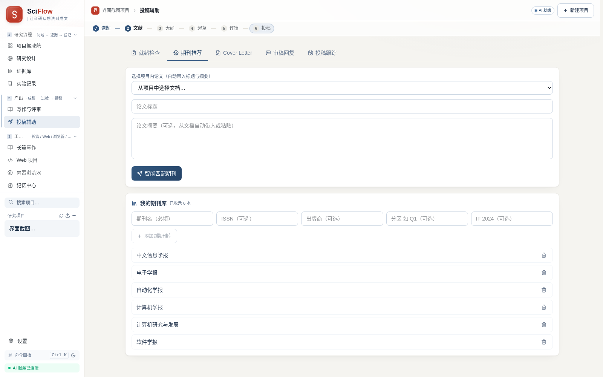
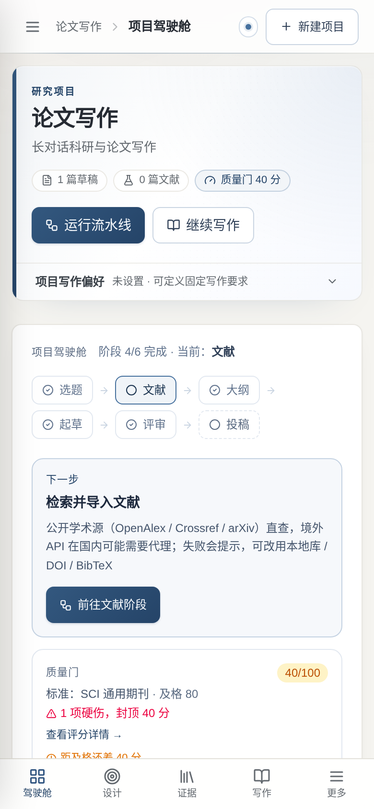

# SciFlow

**Local-first research workbench for literature, writing, review, and submission — with a deterministic quality gate and citations you can trace.**

[](https://github.com/badhope/sciflow/actions/workflows/ci.yml)
[](LICENSE)

**English** · [简体中文](README.zh-CN.md)

SciFlow keeps the research chain on your own machine: one SQLite file, your model endpoint, no hosted account. It is built for researchers who want a fast working tool, not another platform to manage.

## What it does

- **Research loop with real evidence.** PI, experimenter, critic and independent reviewer are separate agents. Protocols pause for human approval, or for an expert agent in automatic mode. Claims need verbatim evidence from a real run.
- **Manuscript pipeline.** Topic check, literature survey, outline gate, section drafting, quality review and citation formatting. Every step writes a checkpoint, so a run can resume after a restart.
- **Quality you can trust.** Seven dimensions are scored by rules with a stable fingerprint. The gate decides pass or fail; the model score is only a reference. A failed draft gets targeted revision, not a reroll.
- **One inbox for files and search.** Chat attachments and the knowledge base share one extractor for PDF/scan OCR, Office, EPUB, images, audio and video. Cmd+K searches documents, conversations, projects, experiments, references and knowledge in one request.
- **Citations that resolve.** Each `[n]` anchor points to a citation row and then to a reference. Ghost anchors, orphans, broken numbering and duplicate DOIs are reported. An empty library blocks citation markers.
- **Submission ready.** Readiness checks, journal templates, cover letter, referenced figures and a deterministic package in one download.
- **Share, comments and automation.** Documents and conversations can be shared as read-only snapshots; comments are opt-in. Schedules trigger on new references, pipeline completion, quality thresholds or failed experiments, with in-app, browser and Feishu notifications.
- **Remote control from your phone.** The desktop app issues a one-time QR link that opens the full workbench on mobile, while the backend stays loopback-only and the gateway only authenticates and proxies. Refresh or stop at any time.

## A look inside

| Research cockpit | Research design and cycle |
| --- | --- |
|  |  |
| **Knowledge and evidence** | **Deterministic quality gate** |
|  |  |
| **Writing and review** | **Submission package** |
|  |  |

## Remote control

The desktop app issues a one-time QR link. The phone opens the full workbench, not a stripped-down companion: projects, research chat, writing, pipelines, approvals and settings all work, while the data and Agent stay on the desktop machine.

<p align="center">
  
  &nbsp;&nbsp;
  
</p>

<sub>Screenshot uses <code>sciflow.example.com</code> as a placeholder public address. On the same Wi-Fi the QR code uses the LAN address; for access outside the LAN, set <code>SCIFLOW_REMOTE_PUBLIC_URL</code> and put an HTTPS reverse proxy in front.</sub>

## Start

Requires Node 20+ and pnpm.

```bash
git clone https://github.com/badhope/sciflow.git
cd sciflow
pnpm install
cp apps/server/.env.example apps/server/.env   # set AI_BASE_URL, AI_API_KEY, AI_MODEL
pnpm build && pnpm start
```

Open `http://localhost:3000`. To try the full pipeline without a model key:

```bash
AI_MOCK=1 DATABASE_PATH=/tmp/sciflow_demo.db PORT=3000 \
  node apps/server/dist/apps/server/src/main.js
node scripts/seed-demo.mjs
```

Desktop and Docker builds are documented in [`docs/DESKTOP.md`](docs/DESKTOP.md) and [`docs/deployment.md`](docs/deployment.md).

## Documentation

- [`docs/PROJECT-BASELINE.md`](docs/PROJECT-BASELINE.md) — current state, shipped inventory, task pool and roadmap
- [`docs/COMPETITIVE-ANALYSIS.md`](docs/COMPETITIVE-ANALYSIS.md) — competitor matrix, scope boundaries and feasibility
- [`ARCHITECTURE.md`](ARCHITECTURE.md) — module boundaries and data flow
- [`docs/CONFIGURATION.md`](docs/CONFIGURATION.md) — model, search, auth and agent settings
- [`docs/OPERATIONS.md`](docs/OPERATIONS.md) — health, backup and failure handling
- [`docs/README.md`](docs/README.md) — full index, with a Chinese link for every page
- [`docs/product-roadmap.md`](docs/product-roadmap.md) — what is shipped and what is deliberately out of scope
- [`docs/COLLABORATION-BOUNDARY.md`](docs/COLLABORATION-BOUNDARY.md) — who can read, comment and revoke a share
- [`docs/ACCEPTANCE-REPORT.md`](docs/ACCEPTANCE-REPORT.md) — 1.19.17 live acceptance evidence, including what is still blocked
- [`CONTRIBUTING.md`](CONTRIBUTING.md) · [`SECURITY.md`](SECURITY.md) · [`CHANGELOG.md`](CHANGELOG.md)

Every guide starts with a clickable `简体中文` switch.

## Limits

The quality gate is rule-based and conservative. Autonomous runs need a capable model for the PI and critic roles. The Python sandbox is a local runner, not a security boundary for hostile code.

## License

MIT. See [`LICENSE`](LICENSE).
