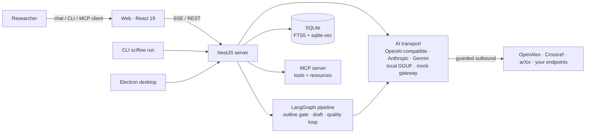

# SciFlow

**A local-first multi-agent research workbench that takes a topic to a submittable manuscript — with every step observable, every citation traceable, and every draft scored against a deterministic quality gate.**

[](https://github.com/Morningstar202604/sciflow/actions/workflows/ci.yml)
[](LICENSE)
[-339933.svg)](package.json)
[](package.json)
[](CHANGELOG.md)

**English** · [简体中文](README.zh-CN.md)

---

## Why teams use it

Most writing tools stop at "generate text". SciFlow runs the whole research loop and refuses to hand back something that does not pass inspection.

| What you get | What it means in practice |
| --- | --- |
| **One pipeline to submission** | Topic validation → literature survey → outline gate → section drafting → quality gate → polish → citation formatting → journal submission tracking |
| **A quality gate, not a vibe check** | Seven deterministic dimensions scored by rules, not an LLM's mood. Below threshold triggers targeted revision up to three rounds |
| **Citations that resolve to a real paper** | Every `[n]` anchor traces to a citation row, then to a reference row. Ghost citations, orphan entries, broken numbering and duplicate DOIs are flagged by number |
| **Nothing hidden in a black box** | Per-step execution trace, token usage, duration Gantt chart, and a deep health probe |
| **Your keys stay yours** | Local SQLite, local embeddings option, bring your own model endpoint. No account required |

## Screenshots

All screenshots are captured from the running application against a seeded demo database.


| Project cockpit | Fully automatic pipeline |
| --- | --- |
|  |  |

| Quality: seven-dimension scoring | Dark mode (same app, ink-night palette) |
| --- | --- |
|  |  |

| Literature screening | Knowledge base: grounded Q&A |
| --- | --- |
|  |  |

| Submission: journals, cover letter, tracking | Experiment sandbox |
| --- | --- |
|  |  |

| Memory center | Settings: models, extensions, hotkeys |
| --- | --- |
|  |  |

## Core capabilities

**Research pipeline.** LangGraph orchestration with a human outline checkpoint. Topic verification, recursive literature survey (depth 1–3), outline with contrarian variants, parallel section drafting, quality gate with automatic revision, polish, and citation formatting. Pipelines checkpoint after each step and resume after a restart.

**Deterministic quality gate.** Seven dimensions — structure, length, citation closure and strength, readability, rhetoric, integrity, information density — evaluated by rules with a stable fingerprint. Five selectable standards from draft iteration to top-journal submission, each with its own length, citation-count and pass thresholds. A manuscript below 90% of the required length is a hard cap, not something decorative points can rescue.

**Citation integrity.** Three-level traceability from text anchor to citation to reference. Seven audit classes including ghost anchors, orphan entries, duplicate DOI and metadata conflict. When the reference pool is empty, drafting prompts forbid citation markers outright, so the model cannot invent references.

**Retrieval that works offline.** sqlite-vec approximate nearest neighbour plus FTS5 trigram full-text, fused with reciprocal rank fusion and de-duplicated by MMR. Embeddings run either through a local GGUF model or through your configured provider's `/embeddings` endpoint. Academic search hits OpenAlex, Crossref and arXiv directly with TTL caching.

**Model freedom.** OpenAI-compatible, Anthropic Messages and Google Gemini protocols. Point it at DeepSeek, Zhipu, Kimi, Qwen, OpenRouter, a local Ollama instance, or anything else that speaks the protocol. Separate fast and strong model tiers, plus endpoint detection and a connection test.

**MCP in both directions.** Expose SciFlow's literature, retrieval and pipeline tools to Claude or any MCP client, and attach external MCP servers as additional tools.

**Headless operation.** `sciflow run --topic "…" --auto --out ./paper/` produces a manuscript without opening a window.

**Agent harness.** The same infrastructure a coding agent needs, applied to research work. A task list the model maintains so long jobs stay auditable instead of opaque. Context compaction that folds earlier turns into a structured digest before the window overflows. `@` mentions that pull a specific paper, document or dataset into the current turn. Tool approval that pauses side-effecting actions (running code, rewriting the manuscript, changing global config) until you confirm — with a readable reason, not a bare tool name.

**Evidence chain.** The writing view shows the argument's provenance as a chain — research question, literature evidence, in-text anchors, citation records, traceable entries — and marks exactly where it breaks. A manuscript with 22 references but zero anchors is reported as two broken links rather than a green check.

## Quick start

Requires Node ≥ 20 (CI uses 22) and pnpm 11.7.0.

```bash
git clone https://gitcode.com/badhope/sciflow.git
cd sciflow
pnpm install
pnpm doctor
cp apps/server/.env.example apps/server/.env
# set AI_BASE_URL, AI_API_KEY and AI_MODEL in apps/server/.env
pnpm build
pnpm start
```

Open `http://localhost:3000`, or run the web dev server separately with `pnpm dev:web`.

### Try it without an API key

The deterministic mock gateway exercises the entire pipeline locally:

```bash
AI_MOCK=1 DATABASE_PATH=/tmp/sciflow_demo.db PORT=3000 \
  node apps/server/dist/apps/server/src/main.js
node scripts/seed-demo.mjs
```

### Docker

```bash
docker compose up --build                              # development
docker compose -f docker-compose.prod.yml up --build    # production
```

### Desktop

```bash
pnpm build && pnpm icons
pnpm desktop:dev     # development
pnpm desktop:dist    # installer in apps/desktop/dist/
```

No local C++ toolchain? Push a tag (`v*`) — the [`desktop-installer` workflow](.github/workflows/desktop-installer.yml) builds the Windows NSIS installer on a GitHub runner and attaches it to the release. Native modules use better-sqlite3's official Electron prebuilds first, and fall back to source rebuild only when needed.

## Configuration

Everything lives in `apps/server/.env`. The settings page covers the same options with a connection test and model discovery, so the file is optional for interactive use.

| Variable | Purpose |
| --- | --- |
| `AI_BASE_URL` · `AI_API_KEY` · `AI_MODEL` | Primary model endpoint |
| `AI_PROTOCOL` | `openai-compatible` (default), `anthropic`, or `gemini` |
| `AI_MODEL_FAST` · `AI_MODEL_STRONG` | Tier routing for cheap and heavy steps |
| `AI_RPM_CAP` | Requests-per-minute ceiling |
| `DATABASE_PATH` | SQLite file location |
| `AUTH_MODE` | `none` for local use, `jwt` for shared deployments |
| `ALLOW_PRIVATE_OUTBOUND` | Permit loopback and RFC1918 targets for local model servers |

See [`docs/CONFIGURATION.md`](docs/CONFIGURATION.md) for scenario-based guidance.

## Verification

Every number below comes from a command that was actually executed on the current tree.

| Check | Command | Result |
| --- | --- | --- |
| Server unit and integration | `pnpm --filter @sciflow/server test` | 47 files, 376 tests |
| Web unit | `pnpm --filter @sciflow/web test` | 21 files, 135 tests |
| Types | `pnpm -r typecheck` | clean |
| Lint | `pnpm lint` | 0 errors |
| Build | `pnpm -r build` | success |
| Black-box regression | `python scripts/full_regression.py` | 240 passed, 0 failed |
| Route probe | `python scripts/route_probe.py` | 96 routes, 0 failures |
| Config monitor | `node scripts/monitor_config_center.mjs` | 25 of 25 |
| Access boundary | `node scripts/verify-jwt-access.mjs` | 28 of 28 |
| Dependencies | `pnpm audit --registry=https://registry.npmjs.org` | no known vulnerabilities |

## Architecture



| Package | Stack |
| --- | --- |
| `apps/server` | NestJS 11 · Drizzle · better-sqlite3 (WAL) · Vercel AI SDK v7 · LangGraph · MCP SDK |
| `apps/web` | React 19 · Vite 6 · Tailwind v4 · TanStack Query/Table · Recharts · CodeMirror 6 |
| `apps/desktop` | Electron 41 · embedded server · electron-builder |
| `packages/core` | Quality audit · citation audit · address policy · pipeline step registry |
| `packages/ai` | Transport · model catalog · guarded outbound fetch · fallback chain · mock gateway |
| `packages/db` | Schema · migrations · secret encryption |
| `packages/retrieval` | Vector + full-text retrieval · RRF fusion · MMR · embeddings |

State chain: `Project → Document (versioned) → Citation → Reference`, with `PipelineTask`, `AgentExecution`, `ReflexionLog`, `MemoryLog`, `LlmCallLog` recording state, traces, revision rounds, memory and cost. Deep detail in [`ARCHITECTURE.md`](ARCHITECTURE.md) and the ecosystem audit in [`docs/ECOSYSTEM-AUDIT.md`](docs/ECOSYSTEM-AUDIT.md).

## Documentation

| Document | Contents |
| --- | --- |
| [`ARCHITECTURE.md`](ARCHITECTURE.md) | Module boundaries, data flow, contracts and decision records |
| [`docs/CONFIGURATION.md`](docs/CONFIGURATION.md) | Model, search, auth and CLI configuration by scenario |
| [`docs/OPERATIONS.md`](docs/OPERATIONS.md) | Health probes, backup and restore, failure modes |
| [`docs/deployment.md`](docs/deployment.md) | Docker, desktop packaging and production notes |
| [`docs/development.md`](docs/development.md) | Local development workflow |
| [`docs/BRAND.md`](docs/BRAND.md) | Visual identity and design tokens |
| [`docs/product-roadmap.md`](docs/product-roadmap.md) | Capability matrix and planned work |
| [`CONTRIBUTING.md`](CONTRIBUTING.md) | Branching, commits, review and release flow |
| [`SECURITY.md`](SECURITY.md) | Threat model and disclosure policy |
| [`CHANGELOG.md`](CHANGELOG.md) | Release history |

## Project status

Current release: **1.11.0**. See [`CHANGELOG.md`](CHANGELOG.md) for the full history and [`docs/product-roadmap.md`](docs/product-roadmap.md) for what is next.

Known gaps: real-model end-to-end runs require your own API key; Docker and Playwright suites are exercised in CI but not on every contributor machine; the desktop installer requires a C++ toolchain on Windows.

## License

MIT. See [`LICENSE`](LICENSE).
