# SciFlow —— 本地优先的 AI 科研工作台

> **从研究主题到可投稿论文，一条流水线跑完：文献调研 → 大纲（可切换反共识方案）→ 分章起草 → 质量门回炉 → 润色 → 引用 → 投稿辅助。**
> 数据、模型 Key、文献、记忆全部留在你自己的机器上——无云端、无多租户、无锁定。

[](https://github.com/Morningstar202604/sciflow/actions/workflows/ci.yml)
[](LICENSE)
[-339933.svg)](package.json)
[](package.json)
[](CHANGELOG.md)

> **🌐 语言 / Language：[中文](README.md) · [English](README.en.md)**

> **仓库镜像（五平台同步）**
> [GitCode](https://gitcode.com/badhope/sciflow) · [Gitee](https://gitee.com/badhope/sciflow) · [GitHub · badhope](https://github.com/badhope/sciflow) · [GitHub · X33834](https://github.com/X33834/sciflow) · [GitHub · Morningstar202604](https://github.com/Morningstar202604/sciflow)
> GitHub 三仓运行同一套 CI：lint · typecheck ×2 · vitest ×2 · build ×2 · mock 全量回归（178 项）· promptfoo 契约评估 · Playwright 冒烟；GitCode 与 Gitee 同步同一发布树。

<!-- 架构一览（Mermaid 随 README 渲染，无需图片资产） -->

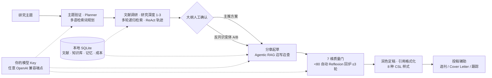

## 🗞 最近更新

- **2026-10-24 · v1.0.0**：研究深度参数（depth 1-3 多轮递归检索）、反共识大纲变体（F2 反同质化）、实验设计助手（F3）、步骤耗时甘特图、CLI headless 全流程 `sciflow run`、MCP resources、深度健康探针。
- **2026-10-23 · v0.11.0**：品牌「墨流」新标识；科研问答并入工作台（唯一对话入口，本地多会话 + slash 指令 + 追问建议）。
- **2026-10-23 · v0.10.0**：统一聊天内核 / 全局快捷键注册表 / 项目阶段条 / 可拖拽分栏。
- **2026-10-23 · v0.9.0**：全维度审查 35 条修复（PATCH 白名单、CSL 去重两个 Critical）+ 品牌/触屏/对比度打磨。

完整历史见 [`CHANGELOG.md`](CHANGELOG.md)。

## 📸 界面预览

> 全部截图来自真实运行实例（1600×1000，本机 mock 网关，演示数据由 `scripts/seed-demo.mjs` 生成），未做任何拼贴或美化。

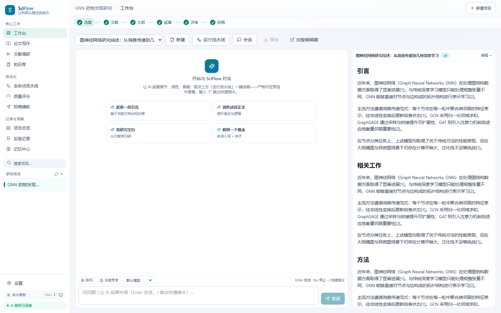

| 全自动流水线 · 深度选择 + 步骤耗时 | 质量评分 · 7 维雷达 |
| --- | --- |
| 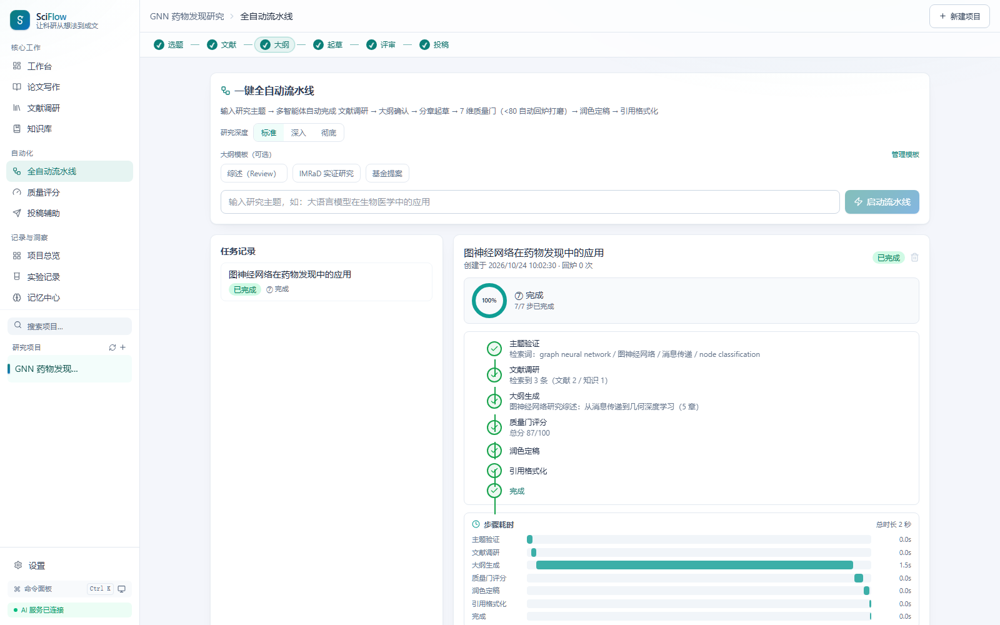 | 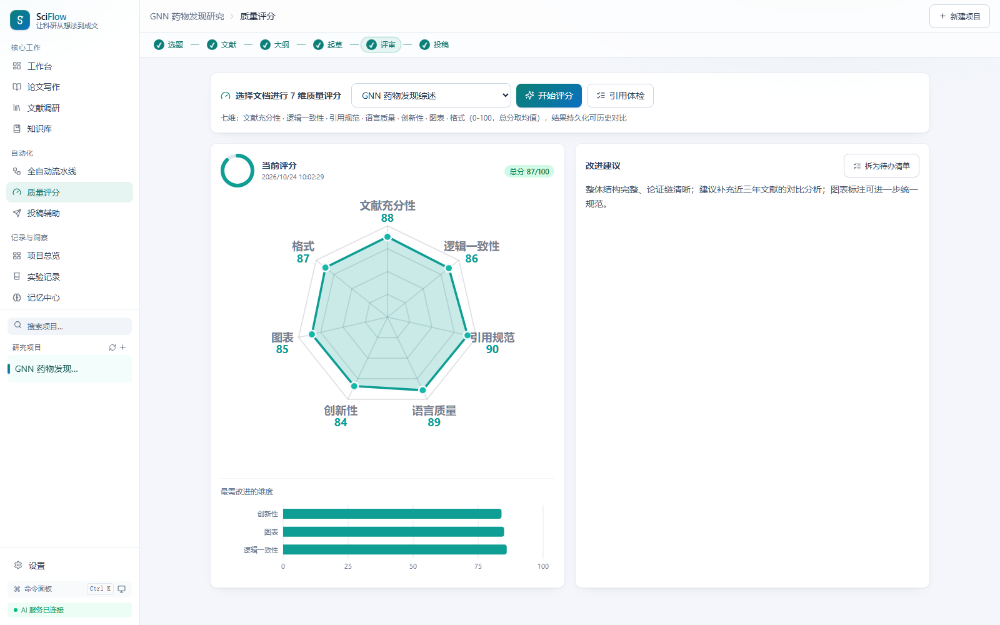 |

| 论文写作 · 大纲 + 分栏预览 | 文献调研 · 筛选与阅读状态 |
| --- | --- |
| 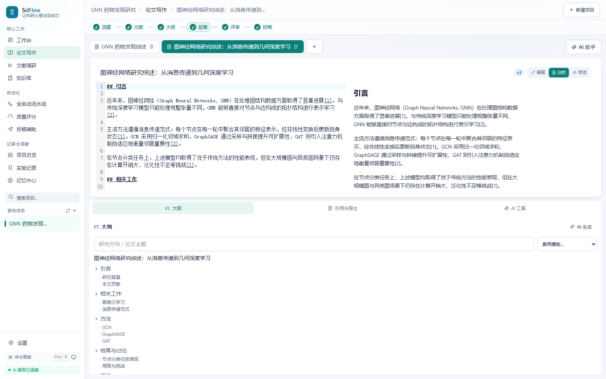 | 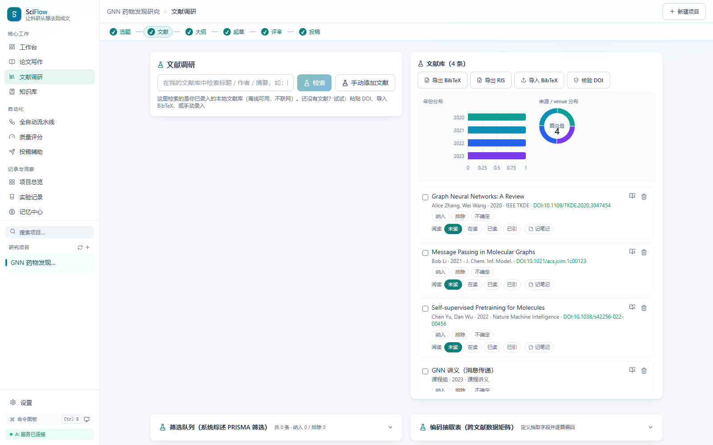 |

| 知识库 RAG · 资料问答 | 项目总览 · 全链路待办 |
| --- | --- |
|  | 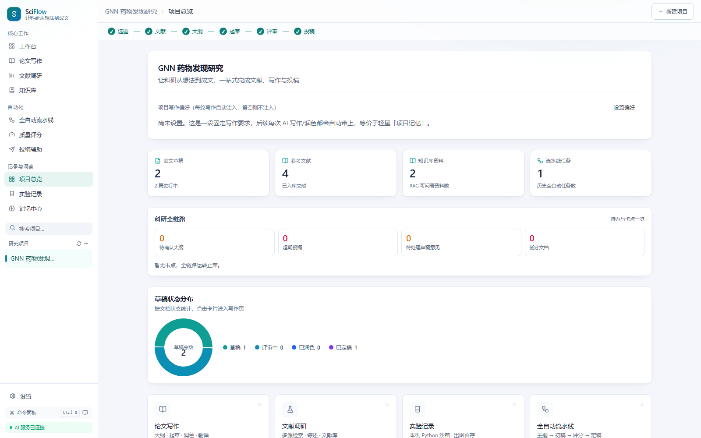 |

| 实验沙箱 + 实验设计助手 | 投稿辅助 · 期刊匹配/投稿信/跟踪 |
| --- | --- |
| 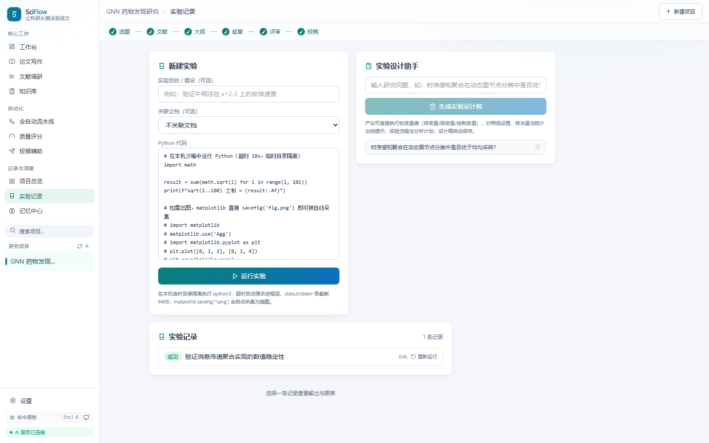 | 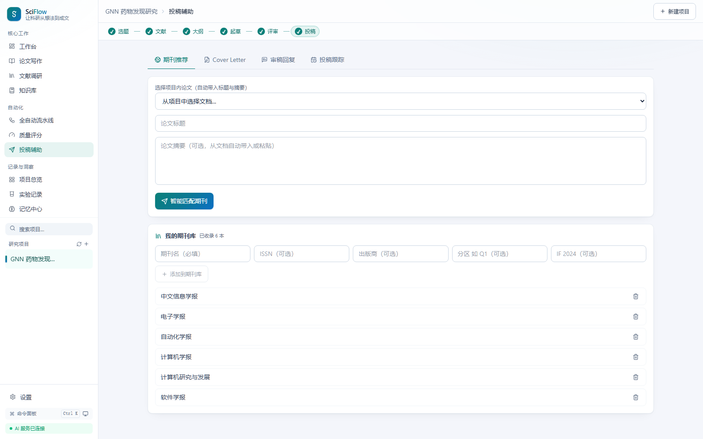 |

| 记忆中心 · 情景/程序记忆 | 设置 · 快捷键速查与用量成本 |
| --- | --- |
| 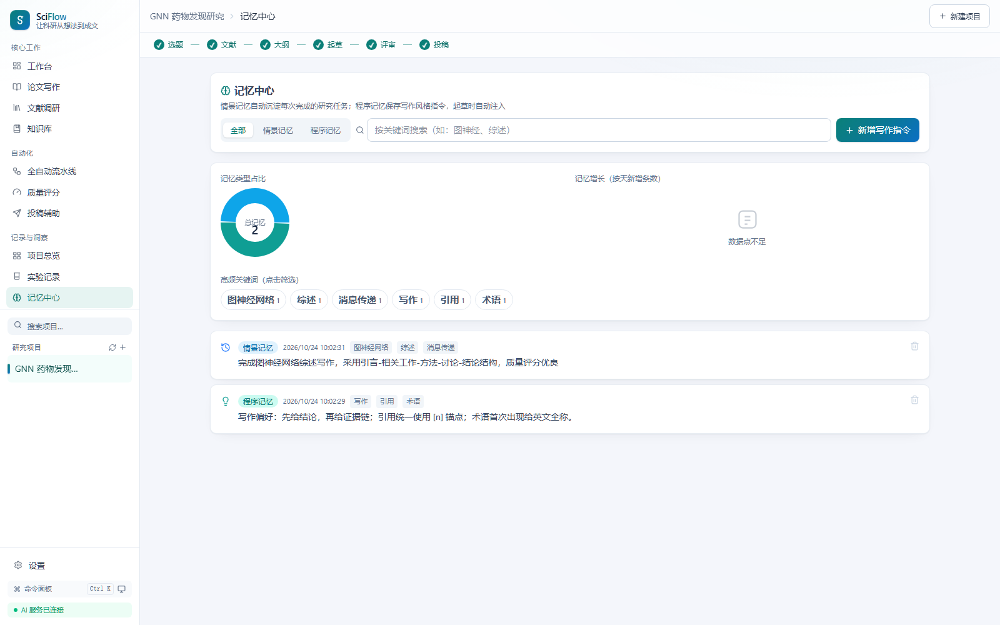 | 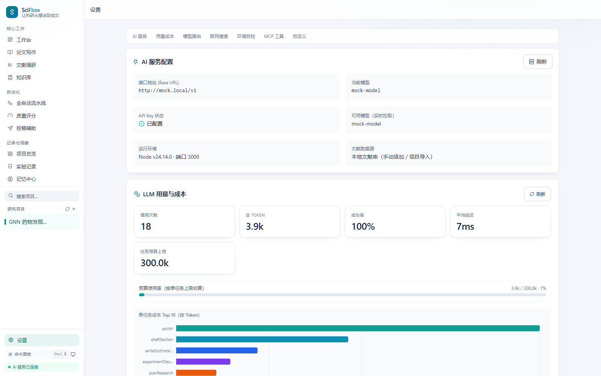 |

**25 秒功能导览视频**：[`docs/media/demo.mp4`](docs/media/demo.mp4)（Playwright 真实操作录制：工作台 → 流水线 → 质量评分 → 写作 → 文献 → 知识库 → 实验 → 深色模式）

### 设计语言

| 维度 | 规范 |
| --- | --- |
| 品牌 | 一笔流线 S + 科研流体渐变（teal → cyan → sky），见 [`docs/BRAND.md`](docs/BRAND.md) |
| 色彩 | 品牌渐变三档均 ≥ 4.5:1（白字），`--on-brand` 在深色模式自动切深墨字（≥ 6.8:1） |
| 布局 | 内容页统一 `--page-max: 1152px`；导航/工具栏/内容三区固定，页面只负责内容 |
| 排版 | 正文 14px / 辅助 12px / 下限 11px；中英文混排统一行高 1.6–1.75 |
| 主题 | 浅色 / 深色 / 跟随系统（`index.html` 预置脚本，刷新无闪白） |
| 无障碍 | 全站 h1、焦点环、Modal 焦点陷阱、Esc、触屏操作常显、危险操作二次确认 |

## ✨ 特性

### 写作与定稿
- **大纲先行（outline-first）**：AI 生成研究计划与章节大纲，写作页编辑 / 预览 / 分栏三态切换。
- **分章起草 + Agentic RAG**：每章边写边查本地知识库，文内 `[n]` 锚点与文末列表一一对应。
- **学术润色**：三段式润色（原文 + 润色文 + 理由）、中英互译、降重改写；自动保护图表与「参考文献」尾部不被洗掉。
- **多版本历史 + 版本 diff**：每次定稿留存快照，逐版本 LCS 文本比对（`VersionDiffModal`）。
- **一键导出**：Markdown / Word(.docx)，投稿交稿即用（LaTeX/HTML 导出逻辑已实现，界面入口待接）。

### 引用与文献
- **8 种引用样式**：APA / IEEE / Vancouver / **GB/T 7714** / Nature / Chicago / Springer / ACS。
- **文内锚点重排**：顺序编码制正文 `[n]` 保持插入序；著者-年制按正文首现自动加 a/b 后缀重排（`CiteReorderButton`）。
- **BibTeX / RIS 导入导出**：文献库元数据去重指纹、`reading_status` 状态机（unread / reading / read / cited）。
- **PRISMA 筛选 + 编码矩阵**：文献调研页按纳入/排除标准筛选、编码归纳。
- **力导向引用网络**：sigma.js + graphology + ForceAtlas2（WebGL 渲染）可交互图谱，直观呈现文献间引用关系。

### 知识库 RAG（NotebookLM 式）
- 本地 **sqlite-vec 向量 ANN + FTS5 trigram 全文**混合检索（嵌入模型不可用时自动回退全文；中文查询 3-gram OR 展开）；知识库资料与文献双向绑定，命中块带来源作者/年份卡片。

### 全自动流水线
- **LangGraph 编排 + 人工确认点**：主题验证 → 文献调研 → 大纲生成 → **大纲人工确认（interrupt）** → 分章起草（并行，并发数可配）→ **7 维质量门**（<80 触发 Reflexion 回炉，最多 3 轮，自动取最高分轮次定稿）→ 润色 → 引用格式化；对话工作台内直接确认与续跑。
- **研究深度（对标 deep research 的 depth 语义）**：标准 / 深入 / 彻底三档——文献调研按轮递归，第 2+ 轮由 Planner 依据上一轮发现给出新检索词，命中跨轮去重合并，零新增自动收敛。
- **反共识大纲变体（反同质化引擎）**：大纲阶段一次产出「主推方案 + 2 个反共识变体」（挑战主流假设 / 另起组织框架），工作台与流水线页均可一键切换对比后采用；模型不支持时自动回退单大纲。
- **Checkpoint 断点续跑**：服务重启后自动恢复中断任务，从草稿阶段幂等续跑。
- **步骤耗时甘特图**：每步真实起止时间的耗时条，哪一步最烧时间一眼可见。
- **模型路由**：fast / strong 双档，问答润色走快模型，规划/长文/评审自动切强模型。

### 质量与评审
- **7 维质量评分**：文献 / 逻辑 / 引用 / 语言 / 创新 / 图表 / 格式（0–100），Recharts 雷达图 + 历史评分对比。
- **审稿闭环**：审稿意见结构化解析、逐条回复模板、修回截止日倒计时。

### 投稿辅助
- 选刊匹配（按主题/范围推荐）、Cover Letter 生成、投稿状态跟踪（投稿→under review→修回→录用/拒稿→转投串联）。

### 实验与记忆
- **实验设计助手**：研究问题 → 可执行的结构化设计稿（自变量/因变量/控制变量、对照组、样本量与统计功效提示、实验流程、分析计划、效度风险），落库可复看。
- **实验沙箱**：隔离 `spawn` 执行 Python 脚本（`SANDBOX_PYTHON` / `SANDBOX_TIMEOUT_MS` 可配），资源上限防护，降级时给出引导。
- **记忆中心**：情景记忆（项目自动沉淀）+ 程序记忆（写作风格指令，起草自动注入）。
- **学习复盘卡 / 思维导图**：流水线复盘要点结构化沉淀。

### 体验细节
- **⌘K 命令面板**：命令注册表单一来源（label + 关键词双通道模糊匹配）；全局快捷键注册表 + 设置页速查表；`#/` hash 路由深层链接直达。
- **统一对话内核**：工作台（唯一对话入口）多会话 / 深度思考 / 联网 / slash 快捷指令 / 追问建议 / 来源卡引用进草稿 / 断点续写，三处聊天面共用同一实现。
- **MCP 工具台 + resources**：AI 能力协议化为标准 MCP 工具（设置页可视化调用）；`sciflow://` 资源把项目文档/文献清单只读暴露给 Claude Desktop 等客户端。
- **CLI headless**：`sciflow run --topic "主题" --auto --depth 2 --out ./paper/` 一条命令出论文（Markdown），对标 GPT-Researcher CLI。
- **深度健康探针**：`GET /api/health/deep` 三探针（db 时延 / 向量扩展 / AI 配置），运维与桌面托盘可直接消费。
- 全站错误文案中文化、移动端窄屏适配、品牌渐变视觉系统（对比度 ≥ AA）。

## 🆚 与同类项目的定位差异

| | SciFlow | Stanford STORM | Elicit | GPT-Researcher | NotebookLM |
| --- | --- | --- | --- | --- | --- |
| 部署形态 | **本地单机**（SQLite 单文件 / Docker / 桌面端） | 云服务 + 开源库 | 云 SaaS | 自托管 / 云 | 云（Google） |
| 模型 | **自带 Key，任意 OpenAI 兼容端点（含 Ollama 本地）** | 指定云模型 | 内置 | 自带 Key | 内置 |
| 数据隐私 | **全部本地，零第三方上传** | 云端 | 云端 | 视部署 | 云端 |
| 全流程 | 选题 → 文献 → 大纲 → 起草 → 质量门 → 引用 → **投稿跟踪** | 维基式报告 | 系统综述抽取 | 研究报告 | 笔记问答 |
| 引用管理 | **8 种 CSL 样式实时重排 + 引用体检 + 文献库指纹去重** | 脚注 | 抽取表 | 引用列表 | 来源标注 |
| 反同质化 | **反共识大纲变体 + 研究深度多轮递归** | 多视角提问 | — | 递归深度 | — |
| 投稿环节 | **选刊匹配 / Cover Letter / 审稿回复 / 状态跟踪** | — | — | — | — |
| 中文科研适配 | **GB/T 7714、国内期刊库、中文分词检索** | 弱 | 弱 | 弱 | 弱 |

> STORM/Elicit/NotebookLM 是优秀的云服务，SciFlow 不与之拼数据壁垒——只打「**本地优先 + 全流程闭环 + AI 失效模式治理**」这一仗：引用可溯源、质量门不达标自动回炉、成本有预算闸。

## 🏗 技术栈

| 端 | 技术 |
| --- | --- |
| 后端 `apps/server` | NestJS 11 · TypeScript（strict）· Drizzle ORM · better-sqlite3（WAL）· Vercel AI SDK（OpenAI 兼容）· LangGraph（编排 / 断点续跑 / 人工确认）· MCP 官方 SDK · zod · helmet + pino · MSW 进程内 mock 网关 |
| 前端 `apps/web` | React 19 · Vite 6 · TypeScript · Tailwind CSS v4 · TanStack Query / Table · Recharts · sigma.js + graphology · streamdown（流式 Markdown）· CodeMirror 6 · react-markdown + KaTeX |
| 桌面端 `apps/desktop` | Electron 41（内嵌 Node 24，原生支持 require(ESM)）· 内嵌后端（`ELECTRON_RUN_AS_NODE`）· 本地 SQLite（userData 隔离，打包时自动按 Electron ABI 重编原生模块）· electron-builder 三平台打包 · electron-updater 自动更新（opt-in） |
| 工程 | pnpm workspace · vitest（server 99 / web 62）· Playwright 冒烟 · promptfoo 契约评估 · GitHub Actions 三 job（类型/单测/构建 · 全量回归 · E2E+评测）· Python 3 回归脚本（167 项） |

**架构概览**

```
apps/server/src/   后端模块（NestJS）
├── ai/            AI SDK 模型层 + Prompt 模板 + MSW mock 网关 + 全局令牌桶限流
├── projects/      项目管理        ├── documents/   文档/润色/翻译/引用/版本/导出
├── references/    文献库 + 综述     ├── knowledge/   RAG 知识库（向量 + FTS5 全文）
├── pipeline/      LangGraph 编排（interrupt/checkpointer）├── agent/  Agent 执行轨迹
├── research/      文献调研 + 质量评分 + 投稿辅助（controller 集中于此）
├── judgment/      评审闭环         ├── experiments/  实验沙箱
├── chat/          SSE 流式问答     ├── memory/       情景/程序记忆
├── mcp/           MCP 工具协议化    ├── settings/     设置/模型连通自检
├── dashboard/     工作台聚合       ├── db/          Drizzle schema + SQLite
└── common/        输入校验等公共件

apps/web/src/pages/  前端页面
Dashboard(工作台) · Writing(论文写作) · Literature(文献调研) · Knowledge(知识库)
Pipeline(全自动流水线) · Quality(质量评分) · Experiments(实验记录) · Memory(记忆中心)
Chat(科研问答) · Submission(投稿辅助) · Settings(设置)
```

数据链条：`Project → Document（多版本）→ Citation → Reference（真实可追溯）`；`PipelineTask` / `AgentExecution` / `ReflexionLog` / `MemoryLog` / `LlmCallLog` 分别记录流水线状态、Agent 执行轨迹、回炉反思、记忆沉淀与 token 成本。

## 🚀 快速开始

要求：Node ≥ 20（CI 锁定 Node 22）、pnpm ≥ 9（本仓库锁定 `pnpm@11.7.0`）

```bash
# 1. 克隆并安装依赖
git clone <你的仓库镜像地址> sciflow && cd sciflow
pnpm install

# 2. 先跑环境自检（Node/依赖/目录/端口/AI/向量/Python 一次看全）
pnpm doctor        # 有问题会给出具体修复动作；可加 --fix 自动修复安全项

# 3. 配置 AI（复制模板并填写你自己的 Key；模板已含全部变量说明）
cp apps/server/.env.example apps/server/.env
#    编辑 apps/server/.env：至少填 AI_BASE_URL / AI_API_KEY / AI_MODEL

# 4. 编译后端
pnpm --filter @sciflow/server build

# 5. 启动（两个终端）
#    后端 :3000
node apps/server/dist/apps/server/src/main.js
#    前端 :5173
pnpm --filter @sciflow/web dev

# 6. 浏览器打开
#    http://localhost:5173
```

**没有任何 Key？** 30 秒跑通全流程演示（进程内 mock 网关 + 演示数据）：

```bash
AI_MOCK=1 DATABASE_PATH=/tmp/sciflow_demo.db PORT=3000 node apps/server/dist/apps/server/src/main.js
node scripts/seed-demo.mjs && RUN_PIPELINE=1 node scripts/seed-demo.mjs
```

> SQLite 首次启动自动建表（默认 `apps/server/data/sciflow.db`），零配置开箱即跑。
> 后端默认仅监听 `127.0.0.1`；确需局域网暴露时显式设置 `HOST=0.0.0.0`。

### 🖥 桌面应用端（可选）

```bash
pnpm install && pnpm build          # 先构建后端与前端
pnpm icons                          # 从矢量母版生成应用图标（首次）
pnpm desktop:dev                    # 开发调试（前端 dev server + 桌面壳）
pnpm desktop:dist                   # 打包当前平台安装包 → apps/desktop/release/
```

数据落平台规范目录（Windows `%APPDATA%\SciFlow`），离线可用；详见 [`apps/desktop/README.md`](apps/desktop/README.md) 与 [`docs/BRAND.md`](docs/BRAND.md)。

## ⌨️ CLI headless（无人值守出论文）

```bash
node apps/server/dist/apps/server/src/cli.js run   --topic "图神经网络在生物医药中的应用综述"   --auto --depth 2 --out ./paper/
# --auto      自动确认大纲（不加则在大纲确认点停下，exit 2）
# --depth 1-3 研究深度（多轮递归检索）
# --out 目录  完成后写入 ./paper/<论文标题>.md
```

其余命令：`health` / `project list` / `pipeline run|status` / `doc export` / `mcp serve`（stdio MCP Server，Claude Desktop 可直连）。

## 🔑 AI 配置说明

SciFlow 支持**任意 OpenAI 兼容端点**，只需要填 `base_url` + `model` + `key`：

| 变量 | 说明 | 示例值（占位，非真实 Key） |
| --- | --- | --- |
| `AI_BASE_URL` | OpenAI 兼容接口地址 | `https://api.deepseek.com/v1` |
| `AI_API_KEY` | 你的 API 密钥 | `sk-your-api-key-here` |
| `AI_MODEL` | 默认模型 | `deepseek-chat` |
| `AI_MODEL_FAST` | fast 档（问答/润色/翻译/评审 JSON） | 留空则回落 `AI_MODEL` |
| `AI_MODEL_STRONG` | strong 档（规划/长文起草） | 留空则回落 `AI_MODEL` |
| `AI_RPM_CAP` | 每分钟 AI 调用上限（令牌桶防 429） | `8`（长流水线建议 100+） |
| `AI_MOCK` | 设为 `1` 启用进程内 mock 网关（MSW 拦截，无 Key / 无外网跑全链路） | `1` |
| `CORS_ORIGIN` | 允许的前端来源（逗号分隔） | `http://localhost:5173` |

兼容端点示例（任选其一，格式均为 `base_url` + 模型名）：火山方舟 `https://ark.cn-beijing.volces.com/api/v3`、DeepSeek `https://api.deepseek.com/v1`、豆包、智谱 `https://open.bigmodel.cn/api/paas/v4`、Kimi `https://api.moonshot.cn/v1`、Ollama 本地 `http://localhost:11434/v1`、云知声 u2-flash 网关等。

> 未配置 Key 时项目管理 / 文献库 / RAG 等本地功能照常可用；AI 功能会给出明确配置提示，**不返回假数据**。

## 🧪 测试与回归

```bash
# 类型检查（双端，CI 强制）
pnpm --filter @sciflow/server typecheck
pnpm --filter @sciflow/web typecheck

# 单元测试（vitest：server 108 条 + web 73 条）
pnpm --filter @sciflow/server test
pnpm --filter @sciflow/web test

# 构建（双端）
pnpm --filter @sciflow/server build && pnpm --filter @sciflow/web build

# E2E 冒烟（Playwright；前置：mock 后端 :3000 + web dev :5173 均已启动）
pnpm exec playwright test e2e/workspace-smoke.spec.ts
# 真实模型端到端（默认跳过，需真实端点）：E2E_REAL=1 pnpm exec playwright test e2e/real-chat.spec.ts

# prompt 契约评估（promptfoo，离线；前置：server build + 下方 mock HTTP 网关）
pnpm exec promptfoo eval -c evals/promptfooconfig.yaml
```

### 内置 mock AI 网关（无 Key / 无外网跑全链路）

`AI_MOCK=1` 时以 **MSW 在进程内拦截**全部 AI 调用（不占端口、零网络），按 prompt 关键词返回**确定性**响应（研究计划/大纲 JSON、带 `[Ref:N]` 的中文章节、≈87 分 7 维评分不回炉、三段式润色、RAG 答案、期刊匹配等），并支持 SSE 分块。

```bash
# 起后端（mock 模式，放宽限流）
AI_MOCK=1 AI_RPM_CAP=120 DATABASE_PATH=/tmp/sciflow_regression.db PORT=3000 \
  node apps/server/dist/apps/server/src/main.js

# 另一终端：全量回归（覆盖全部路由 + 一条流水线端到端产物断言）
# ⚠️ 必须使用全新数据库：脏库会让指纹去重/字段唯一性等用例误报失败
SCIFLOW_BASE=http://localhost:3000 AI_MOCK=1 \
  python3 scripts/full_regression.py
```

> 外部工具（如 promptfoo）需要真实 HTTP 端点时：`node apps/server/scripts/mock-openai-http.mjs`——复用同一路由表，监听 `127.0.0.1:5099`。

回归基线（全新库 + mock 网关实测，见 `scripts/full_regression.py`）：**PASS 178 / FAIL 0 / KNOWN 0**（KNOWN 机制保留但当前为空集：历史 11 项存量缺口已全部修复）。mock 网关仅用于测试/演示，不代表真实模型能力。

## 📚 文档索引

| 文档 | 内容 |
| --- | --- |
| [`ARCHITECTURE.md`](ARCHITECTURE.md) | 架构唯一真理源：依赖地图 / 防重复造轮子守则 / 阶段进度与待办 |
| [`docs/product-roadmap.md`](docs/product-roadmap.md) | 产品路线图：现状能力矩阵、设计原则、差距与缺口 |
| [`docs/index.html`](docs/index.html) | 项目官网（静态单页，浏览器直开；GitHub Pages 首页） |
| [`docs/sciflow-code-tree.html`](docs/sciflow-code-tree.html) | 全仓代码树可视化（浏览器打开） |
| [`docs/screenshots/`](docs/screenshots/) | 对话工作台 / 流水线 / 写作 / 质量 / 文献库 / 知识库 实机截图 |
| [`CONTRIBUTING.md`](CONTRIBUTING.md) | 开发环境、提交规范、PR 流程 |
| [`SECURITY.md`](SECURITY.md) | 安全设计要点与漏洞披露方式 |
| [`docs/SECURITY.md`](docs/SECURITY.md) | 安全审计实测结论：4 个高/严重问题的 PoC、修复与复测 |
| [`docs/OPERATIONS.md`](docs/OPERATIONS.md) | 运维手册：SLI/SLO、健康检查、备份恢复实测、故障处置 |
| [`docs/QUALITY-BASELINE.md`](docs/QUALITY-BASELINE.md) | 质量基线看板：覆盖率/复杂度/变异分数实测值与红线判定 |
| [`docs/AUDIT-2026-10-23.md`](docs/AUDIT-2026-10-23.md) | 全维度审查与对标报告（35 条发现、竞品矩阵、路线图，含未修复项） |
| [`CHANGELOG.md`](CHANGELOG.md) | 版本变更记录 |

## 🌱 演示数据

```bash
# 全新库 + mock 网关（无需任何 Key）
AI_MOCK=1 DATABASE_PATH=/tmp/sciflow_demo.db PORT=3000 node apps/server/dist/apps/server/src/main.js
node scripts/seed-demo.mjs          # 1 项目 / 1 文档 / 4 文献 / 质量报告 / 投稿 / 2 份资料 / 1 实验 / 1 实验设计稿
RUN_PIPELINE=1 node scripts/seed-demo.mjs   # 额外跑通全自动流水线（约 30s）
```

`scripts/seed-demo.mjs` 只调用公开 REST API，可重复执行；库里已有项目时自动跳过，不会污染现有数据。全流程产物（文档/版本/引用/记忆）均存于本地 SQLite，删除 `DATABASE_PATH` 指向的 db 文件即可回到干净状态。

## 🐳 Docker 部署

```bash
cp apps/server/.env.example .env   # 按注释填写 AI_BASE_URL / AI_API_KEY / AI_MODEL
docker compose up -d --build      # 前端 nginx 静态托管 :8080 → 后端 :3000
# 容器部署需设置 CORS_ORIGIN=http://localhost:8080
```

## 📜 License

[MIT](LICENSE) © 2026 SciFlow Contributors
