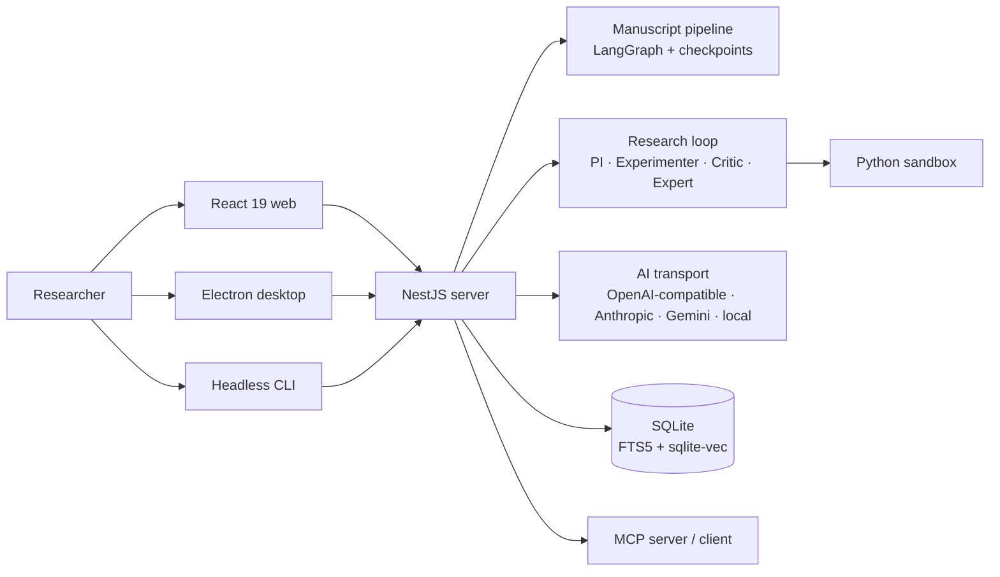

# SciFlow

**A local-first research platform that runs an autonomous research loop and a manuscript pipeline — with deterministic gates that refuse to pass work they cannot verify.**

[](https://github.com/Morningstar202604/sciflow/actions/workflows/ci.yml)
[](LICENSE)
[-339933.svg)](package.json)
[](package.json)
[](CHANGELOG.md)

**English** · [简体中文](README.zh-CN.md)

---

## Why it is different

| | |
|---|---|
| **Autonomous research loop** | Program → Cycle → Question → Hypothesis → Protocol → Run → Claim → Evidence. PI, Experimenter, Critic and an independent Expert reviewer are separate LLM agents. Every protocol passes a gate before execution: human approval, or fully automatic approval by the Expert agent. |
| **Deterministic quality gate** | Seven dimensions scored by rules with a stable fingerprint — same text, same score. The gate is the acceptance criterion; the LLM score is reference only. Below threshold triggers targeted revision, not a reroll. |
| **Citations you can trace** | Every `[n]` anchor resolves to a citation row and then to a reference row. Ghost anchors, orphan entries, broken numbering and duplicate DOIs are reported by number. An empty reference pool forbids citation markers outright. |
| **Evidence, not prose** | Claims are stored with stance, strength and verbatim quotes from experiment stdout. The Critic cannot mark `supported` without a matching `supports` evidence item. |
| **Manuscript pipeline** | Topic validation → literature survey → outline gate → section drafting → quality gate → polish → citation formatting. Checkpoints after every step; restart-safe. |
| **Grounded retrieval** | SQLite FTS5 + sqlite-vec, RRF fusion and MMR; OpenAlex / Crossref / arXiv search with relevance gating and TTL cache. Literature hits enter the research loop as background, never as fabricated citations. |
| **Open by design** | MCP server and client, OpenAI-compatible / Anthropic / Gemini protocols, local Ollama or GGUF, desktop app, headless CLI, JWT mode for shared deployments. |

## What a complete run produces

A verified run on 2026-11-13 with a real model produced a 10,834-character manuscript from 20 retrieved references: 18 citation anchors, 18 citation rows, 0 ghost anchors, objective quality 97/100. The autonomous loop separately produced a supported claim backed by 5 verbatim evidence items from a sandboxed Monte Carlo experiment.

## Quick start

Requires Node ≥ 20 (CI uses 22) and pnpm 11.7.0.

```bash
git clone https://gitcode.com/badhope/sciflow.git
cd sciflow
pnpm install
pnpm doctor
cp apps/server/.env.example apps/server/.env
# set AI_BASE_URL, AI_API_KEY, AI_MODEL in apps/server/.env
pnpm build
pnpm start
```

Open `http://localhost:3000`. For frontend development use `pnpm dev:web`.

### Run without an API key

The deterministic mock gateway exercises the whole pipeline locally:

```bash
AI_MOCK=1 DATABASE_PATH=/tmp/sciflow_demo.db PORT=3000 \
  node apps/server/dist/apps/server/src/main.js
node scripts/seed-demo.mjs
```

### Desktop and Docker

```bash
pnpm build && pnpm icons && pnpm desktop:dev   # Electron
pnpm desktop:dist                              # installer in apps/desktop/release/
docker compose up --build                      # development
docker compose -f docker-compose.prod.yml up --build
```

## Verification

Every number below comes from a command run on the current tree (2026-11-13).

| Check | Command | Result |
|---|---|---|
| Server unit/integration | `pnpm --filter @sciflow/server test` | 84 files, 660 tests |
| Web unit | `pnpm --filter @sciflow/web test` | 29 files, 201 tests |
| Desktop unit | `pnpm --filter @sciflow/desktop test` | 1 file, 5 tests |
| Types / build | `pnpm -r typecheck` · `pnpm -r build` | clean |
| Browser UI sweep | `npx playwright test e2e/ui-sweep.spec.ts` | 4 passed |
| Settings interaction | `npx playwright test e2e/settings-interaction.spec.ts` | 2 passed |
| AI access policy | `pnpm --filter @sciflow/server test -- agent-policy` | 7 passed |
| Real-model manuscript run | pipeline API, 2026-11-13 | 20 refs, 10,834 chars, 18 anchors, 0 ghost, objective 97 |
| Real-model research loop | cycle `50a629be` | supported/90, 5 verified evidence items |

## Architecture



| Package | Stack |
|---|---|
| `apps/server` | NestJS 11 · Drizzle · better-sqlite3 (WAL) · AI SDK v7 · LangGraph · MCP SDK |
| `apps/web` | React 19 · Vite 8 · TanStack Query/Table · Recharts · CodeMirror 6 |
| `apps/desktop` | Electron 42 · embedded server · electron-builder |
| `packages/core` | Quality audit · citation audit · address policy · pipeline steps |
| `packages/ai` | Transport · model catalog · guarded outbound · fallback · mock gateway |
| `packages/db` | Schema · migrations · secret encryption |
| `packages/retrieval` | Vector + full-text retrieval · RRF · MMR · embeddings |

Research data chain: `ResearchProgram → ResearchCycle → ResearchQuestion → ResearchHypothesis → ResearchProtocol → ResearchRun → ResearchClaim → ResearchEvidence`. Manuscript chain: `Project → Document (versioned) → Citation → Reference`.

## Configuration

All settings live in `apps/server/.env`; the settings page covers the same options with a connection test and model discovery.

| Variable | Purpose |
|---|---|
| `AI_BASE_URL` · `AI_API_KEY` · `AI_MODEL` | Primary model endpoint |
| `AI_PROTOCOL` | `openai-compatible` (default), `anthropic`, `gemini` |
| `AI_MODEL_FAST` · `AI_MODEL_STRONG` | Tier routing |
| `AI_RPM_CAP` | Requests-per-minute ceiling |
| `DATABASE_PATH` | SQLite file location |
| `AUTH_MODE` | `none` locally, `jwt` for shared deployments |
| `ALLOW_PRIVATE_OUTBOUND` | Permit loopback/RFC1918 for local model servers |

See [`docs/CONFIGURATION.md`](docs/CONFIGURATION.md).

## Documentation

| Document | Contents |
|---|---|
| [`ARCHITECTURE.md`](ARCHITECTURE.md) | Module boundaries, data flow, contracts |
| [`docs/CONFIGURATION.md`](docs/CONFIGURATION.md) | Model, search, auth and CLI configuration |
| [`docs/OPERATIONS.md`](docs/OPERATIONS.md) | Health probes, backup/restore, failure modes |
| [`docs/deployment.md`](docs/deployment.md) | Docker and desktop packaging |
| [`SECURITY.md`](SECURITY.md) | Threat model and disclosure |
| [`CHANGELOG.md`](CHANGELOG.md) | Release history |

## Status

Current release: **1.15.3**. The autonomous research loop and the manuscript pipeline are both real and covered by tests. Known limits: the quality gate is rule-based and intentionally conservative; autonomous runs need a capable model for the PI/Critic roles; the Python sandbox is local and is not a security boundary for hostile code.

## License

MIT. See [`LICENSE`](LICENSE).
