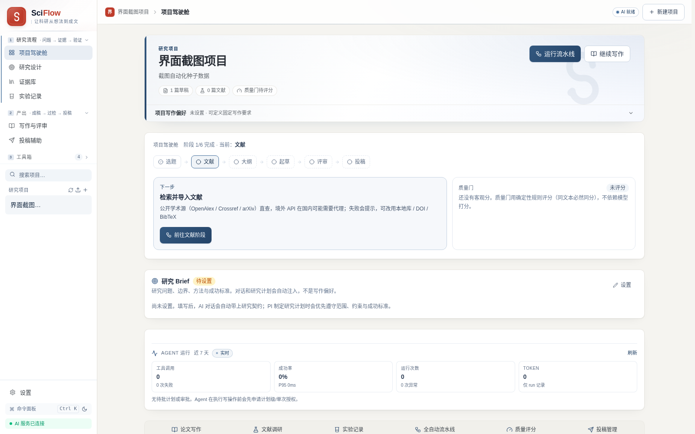
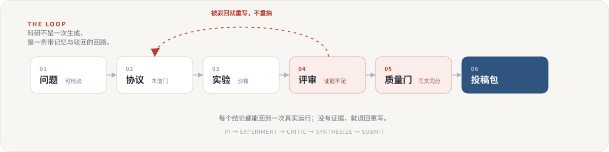
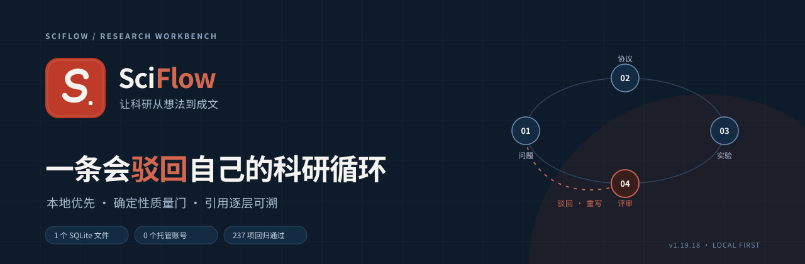

<p align="center">
  
</p>

<h1 align="center">SciFlow</h1>

<p align="center">
  <strong>An AI-native research assistant that takes one research question and runs the full path to a submission package.</strong><br>
  Protocol, experiment, review, manuscript and submission in one loop. The model can suggest; the gate decides.
</p>

<p align="center">
  <a href="https://badhope.github.io/sciflow/">Website</a> ·
  <a href="https://github.com/badhope/sciflow/releases/latest/download/SciFlow-Setup-x64.exe">Download for Windows</a> ·
  <a href="docs/README.md">Documentation</a> ·
  <a href="README.zh-CN.md">简体中文</a>
</p>

<p align="center">
  <a href="https://github.com/badhope/sciflow/actions/workflows/ci.yml"></a>
  <a href="https://github.com/badhope/sciflow/releases"></a>
  
  
  <a href="https://github.com/badhope/sciflow/stargazers"></a>
</p>

<p align="center">
  
</p>

<p align="center"><em>One project, six stages, citations and gate status in one view.</em></p>

## The loop is the product

A research run is not a single answer. It is an end-to-end loop with memory, a rejection path and a paper trail.



- **Memory.** Every protocol, sandbox run, review and revision writes a checkpoint. Stop the process, restart it, and the run continues from where it stopped.
- **Rejection.** A failed review does not reroll the draft. It sends the run back to the protocol with a specific reason, then rewrites the part that failed.
- **Provenance.** Each `[n]` resolves to a citation row, then to a reference. Ghost anchors, orphans, broken numbering and duplicate DOIs are reported before submission.
- **A gate, not a guess.** Seven dimensions are scored by deterministic rules with a stable fingerprint. The gate decides pass or fail; the model score is reference only.

## What the loop delivers

- **A protocol you can run.** Question, scope, hypothesis, success criteria, budget and stop conditions, written before the first experiment.
- **An experiment with evidence.** A sandbox run with logs and artifacts. A claim without verbatim evidence from the run stays unsupported.
- **A manuscript that survived review.** A critic and an independent reviewer can send the draft back with reasons; the revision is targeted, not a reroll.
- **A submission package.** Readiness checks, journal template, cover letter, figures and a deterministic ZIP, ready to hand to the journal.

<p align="center">
  
</p>

## What has been measured

| Real-model loop | Test baseline | Desktop release |
| :---: | :---: | :---: |
| 2 consecutive `supported` runs | 972 server · 277 web tests | `v1.19.18` |
| 0 human approvals | 237 regression checks | Windows x64 installer |

The real-model evidence is in [`docs/verification/assets/research-cycle-real-model-2026-11-24.md`](docs/verification/assets/research-cycle-real-model-2026-11-24.md). The installer and update manifest are on the [latest release](https://github.com/badhope/sciflow/releases/tag/v1.19.18).

## Start

Requires Node 20+ and pnpm.

```bash
git clone https://github.com/badhope/sciflow.git
cd sciflow
pnpm install
cp apps/server/.env.example apps/server/.env   # set AI_BASE_URL, AI_API_KEY, AI_MODEL
pnpm build && pnpm start
```

Open `http://localhost:3000`. To try the loop without a model key:

```bash
AI_MOCK=1 DATABASE_PATH=/tmp/sciflow_demo.db PORT=3000 \
  node apps/server/dist/apps/server/src/main.js
node scripts/seed-demo.mjs
```

Desktop and Docker builds are documented in [`docs/DESKTOP.md`](docs/DESKTOP.md) and [`docs/deployment.md`](docs/deployment.md).

## Documentation

- [`docs/PROJECT-BASELINE.md`](docs/PROJECT-BASELINE.md) — current state, shipped inventory and boundaries
- [`ARCHITECTURE.md`](ARCHITECTURE.md) — module boundaries and data flow
- [`docs/CONFIGURATION.md`](docs/CONFIGURATION.md) — model, search, auth and agent settings
- [`docs/BRAND.md`](docs/BRAND.md) — mark, palette and voice
- [`docs/README.md`](docs/README.md) — full index, with a Chinese link for every page

## Limits

The quality gate is rule-based and conservative. Autonomous runs need a capable model for the PI and critic roles. The Python sandbox is a local runner, not a security boundary for hostile code.

## License

MIT. See [`LICENSE`](LICENSE).

<p align="center">
  <strong>If this loop saves you one revision, a star helps another researcher find it.</strong><br>
  <a href="https://github.com/badhope/sciflow/stargazers">Star SciFlow</a>
</p>
