# SciFlow

**A research workbench that takes a topic to a submittable manuscript — and refuses to hand back anything that fails inspection: a deterministic quality gate, citations that resolve to a real paper, and a verification suite you can rerun yourself.**

[](https://github.com/Morningstar202604/sciflow/actions/workflows/ci.yml)
[](LICENSE)
[-339933.svg)](package.json)
[](package.json)
[](CHANGELOG.md)

**English** · [简体中文](README.zh-CN.md)

---

## What actually makes it different

|  |  |
| --- | --- |
| **One pipeline to submission** | Topic validation → literature survey → outline gate → section drafting → quality gate → polish → citation formatting → journal submission tracking. Checkpoints after every step, resumes after a restart |
| **A quality gate, not a vibe check** | Seven dimensions scored by deterministic rules with a stable fingerprint — same text, same score, reproducible. Below threshold triggers targeted revision, up to three rounds |
| **Citations that resolve to a real paper** | Every `[n]` anchor traces to a citation row, then to a reference row. Ghost anchors, orphan entries, broken numbering and duplicate DOIs are flagged by number. Empty reference pool ⇒ drafting prompts forbid citation markers outright |
| **The evidence chain is visible** | The writing view renders the argument's provenance — research question, literature evidence, in-text anchors, citation records — and marks exactly where it breaks. 22 references with zero anchors is reported as two broken links, not a green check |
| **Guarded autonomy** | Tool approval pauses side-effecting actions with a readable reason; tool-call repetition guard stops loop idling; model fallback chain survives a dead primary endpoint; every LLM call is logged with cost |
| **Claims you can verify** | The verification table below is rerunnable on your machine. If a number is wrong, that's a bug — file it |

## Screenshots

<!-- demo-video -->
[](docs/media/demo.mp4)

*Recorded end-to-end against the shipped build (mock model endpoint, seeded demo data). Click to open the full video.*

All screenshots are captured from the running application against a seeded demo database.

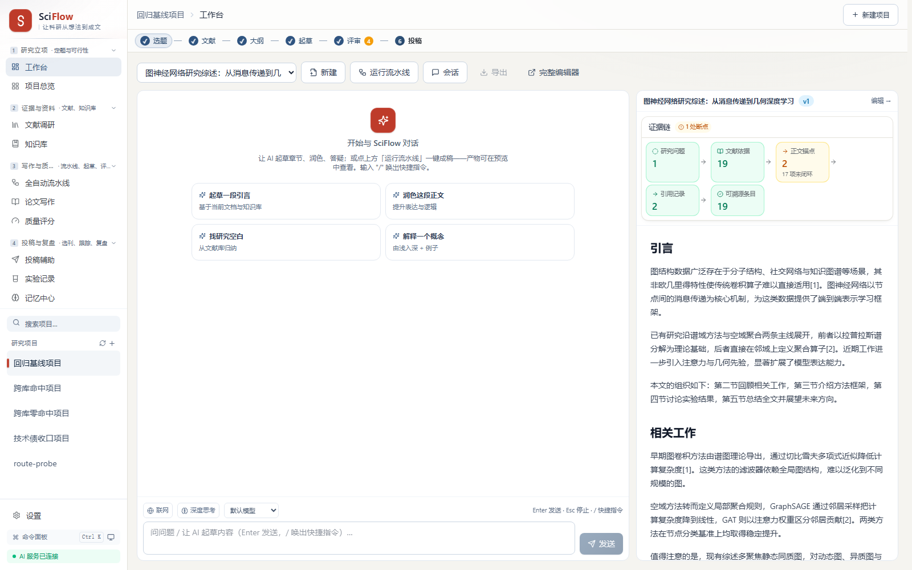

| Project cockpit | Fully automatic pipeline |
| --- | --- |
| 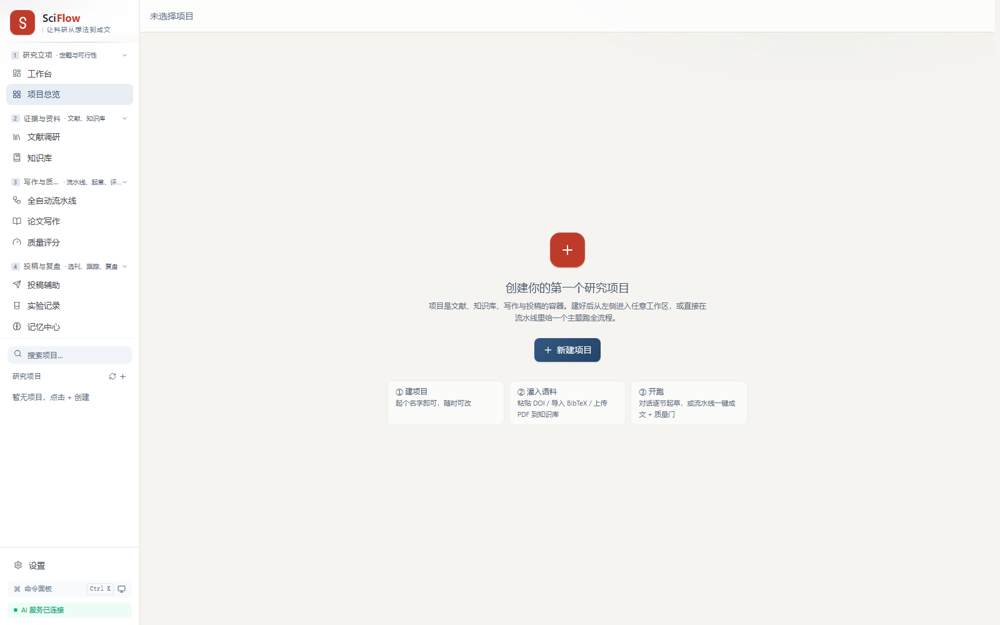 | 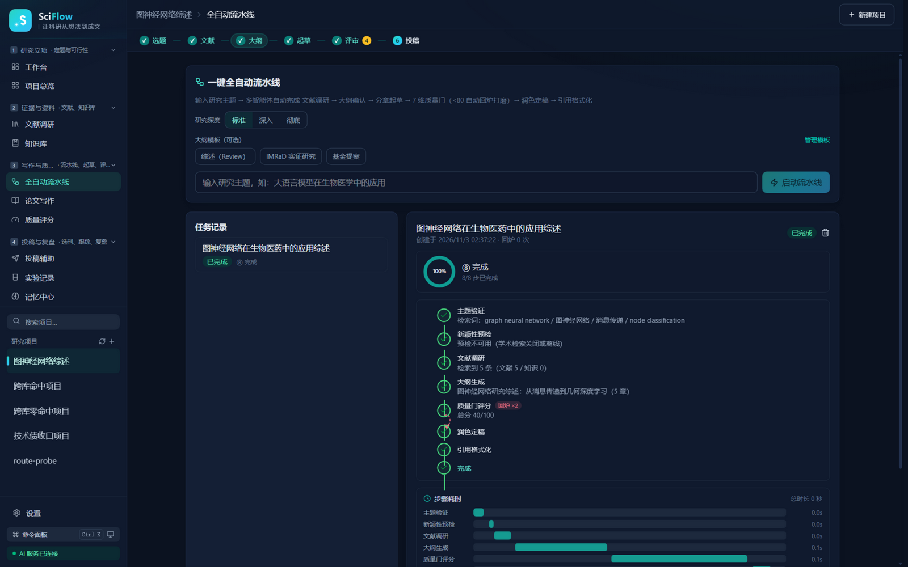 |

| Quality: seven-dimension scoring | Dark mode (same app, ink-night palette) |
| --- | --- |
| 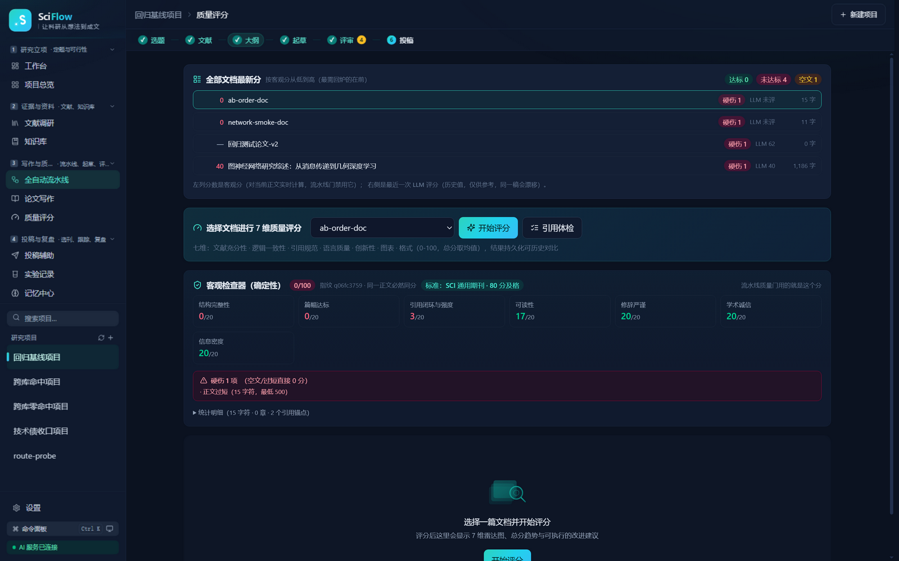 | 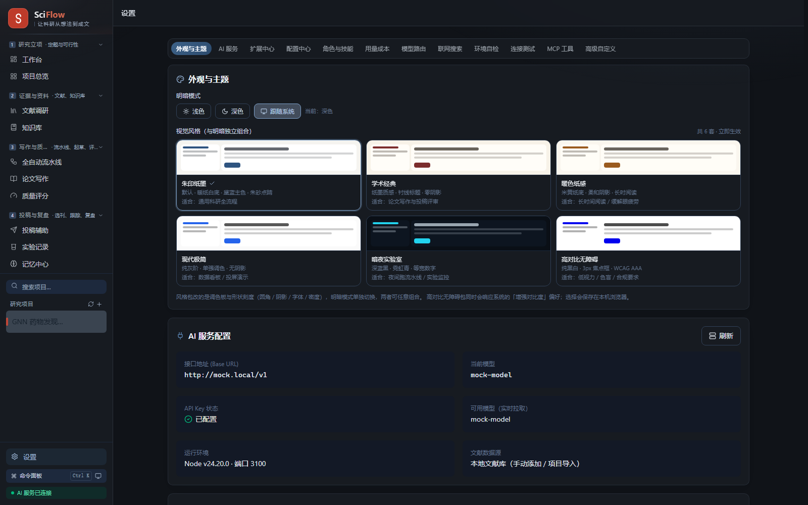 |

| Literature screening | Knowledge base: grounded Q&A |
| --- | --- |
| 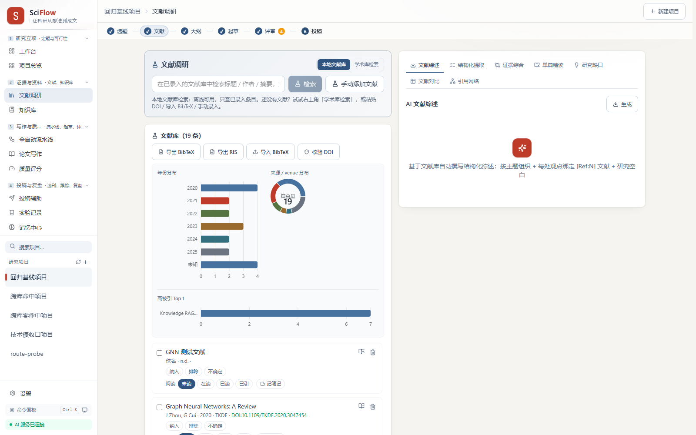 | 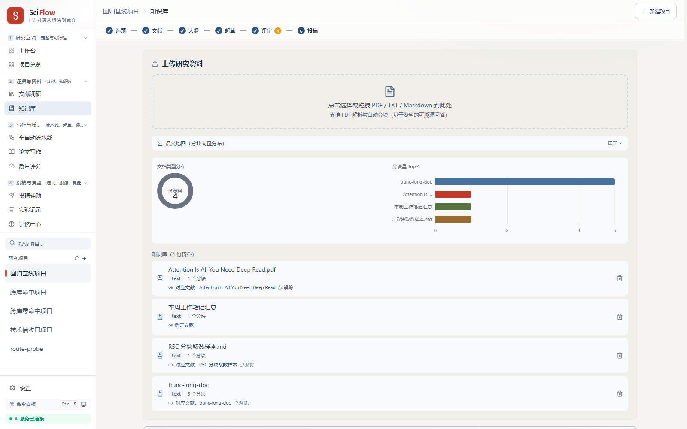 |

| Submission: journals, cover letter, tracking | Experiment sandbox |
| --- | --- |
| 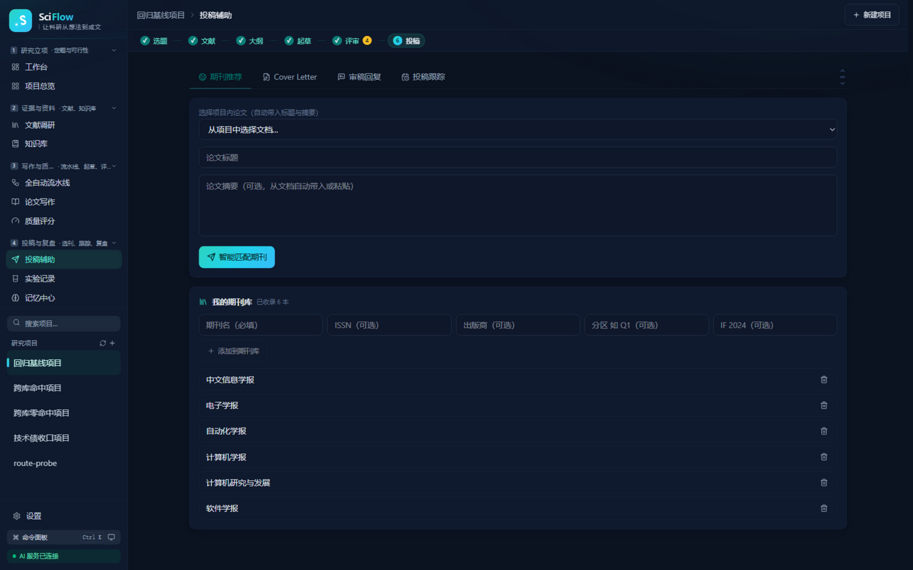 | 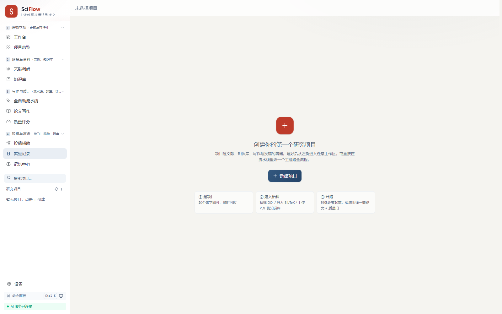 |

| Memory center | Settings: models, extensions, hotkeys |
| --- | --- |
| 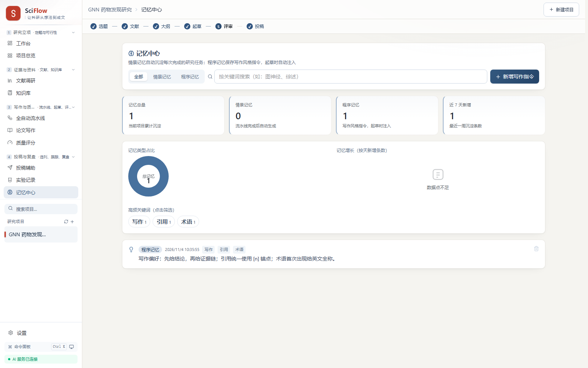 | 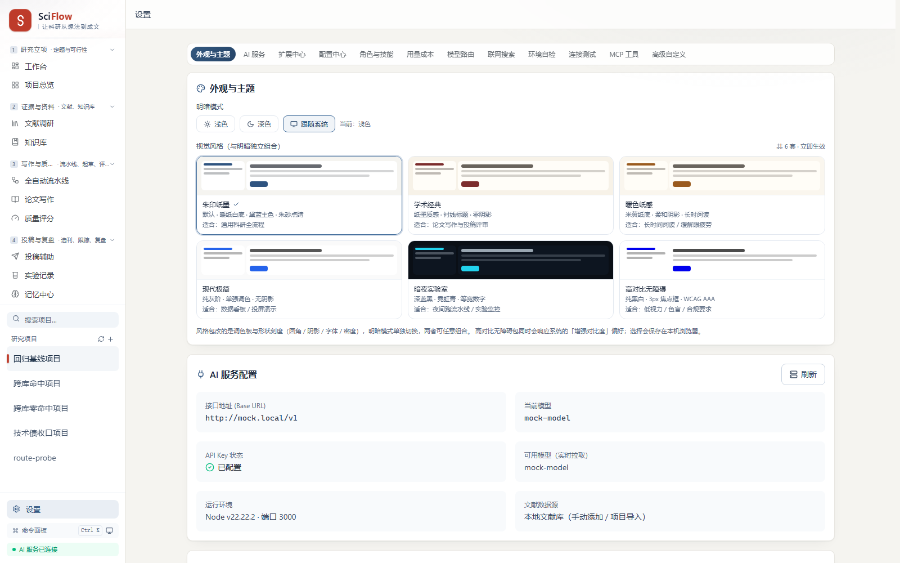 |

## Core capabilities

- **Research pipeline (LangGraph).** Human outline checkpoint, recursive literature survey (depth 1–3), outline with contrarian variants, parallel section drafting, quality gate with automatic revision, polish, citation formatting.
- **Deterministic quality gate.** Seven rule-scored dimensions (structure, length, citation closure and strength, readability, rhetoric, integrity, information density). Five selectable standards from draft iteration to top-journal submission, each with its own length, citation-count and pass thresholds. Below 90% of required length is a hard cap — no decorative points can rescue it.
- **Citation integrity.** Anchor → citation → reference three-level traceability; seven audit classes. The reference pool can't be lied to.
- **Agent harness.** Model-maintained task list, context compaction, `@` mentions for papers/documents, tool approval, tool-call repetition guard (`AGENT_TOOL_REPEAT_LIMIT`), model fallback chain (`AI_MODEL_FALLBACK`).
- **Untrusted-content defense.** External text (literature abstracts, pasted review comments, web search results) is sanitized before it reaches a prompt: invisible Unicode stripped, code-fence smuggling neutralized, and instruction-override / role-hijack / system-probe / tool-lure signals detected deterministically (six signal classes, English and Chinese); flagged passages are wrapped with a one-time random spotlighting mark (OWASP/spotlighting practice).
- **Review reply with a revision plan.** A reply letter now comes back with a structured per-comment revision plan (category, severity, suggested action), optionally linked into the pipeline's `reflexion_log` via `taskId` — the review-to-revision loop starts from data, not vibes.
- **Project bundles.** Export one project as a self-contained JSON (project plus 16 child tables) and import it elsewhere: ids are remapped, foreign keys follow, a name clash becomes "（导入）". Round-trip verified end to end.
- **Operations surface.** `GET /api/metrics` speaks Prometheus text format 0.0.4 (service/db/memory/entity counts, all SQL COUNT, never a table scan); the settings page renders the same numbers plus the config/permission audit trail with a denied-only filter.
- **OTel trace export.** Persisted traces (`llm_call_log`, `agent_execution`) export as OTLP/HTTP-JSON spans with `gen_ai.*` attributes to any collector (`OTEL_EXPORTER_OTLP_ENDPOINT`); disabled with zero overhead when unset.
- **Retrieval.** sqlite-vec + FTS5 trigram, reciprocal-rank fusion, MMR dedup; embeddings via local GGUF or your provider; academic search against OpenAlex, Crossref, arXiv with TTL caching.
- **Model freedom.** OpenAI-compatible / Anthropic / Gemini protocols; fast and strong model tiers; local Ollama or a local GGUF model work the same as a cloud endpoint.
- **MCP in both directions.** Expose SciFlow's tools to any MCP client; attach external MCP servers as additional tools. Handshake verified by [`scripts/mcp-handshake.mjs`](scripts/mcp-handshake.mjs).
- **Headless.** `sciflow run --topic "…" --auto --out ./paper/` produces a manuscript without opening a window.

## Quick start

Requires Node ≥ 20 (CI uses 22) and pnpm 11.7.0.

```bash
git clone https://gitcode.com/badhope/sciflow.git
cd sciflow
pnpm install
pnpm doctor
cp apps/server/.env.example apps/server/.env
# set AI_BASE_URL, AI_API_KEY and AI_MODEL in apps/server/.env
pnpm build
pnpm start
```

Open `http://localhost:3000`, or run the web dev server separately with `pnpm dev:web`.

### Try it without an API key

The deterministic mock gateway exercises the entire pipeline locally:

```bash
AI_MOCK=1 DATABASE_PATH=/tmp/sciflow_demo.db PORT=3000 \
  node apps/server/dist/apps/server/src/main.js
node scripts/seed-demo.mjs
```

### Docker

```bash
docker compose up --build                              # development
docker compose -f docker-compose.prod.yml up --build    # production
```

### Desktop

```bash
pnpm build && pnpm icons
pnpm desktop:dev     # development
pnpm desktop:dist    # installer in apps/desktop/release/
```

No local C++ toolchain? Push a tag (`v*`) — the [`desktop-installer` workflow](.github/workflows/desktop-installer.yml) builds the Windows NSIS installer on a GitHub runner and attaches it to the release. Native modules use better-sqlite3's official Electron prebuilds first, and fall back to source rebuild only when needed.

## Configuration

Everything lives in `apps/server/.env`. The settings page covers the same options with a connection test and model discovery, so the file is optional for interactive use.

| Variable | Purpose |
| --- | --- |
| `AI_BASE_URL` · `AI_API_KEY` · `AI_MODEL` | Primary model endpoint |
| `AI_PROTOCOL` | `openai-compatible` (default), `anthropic`, or `gemini` |
| `AI_MODEL_FAST` · `AI_MODEL_STRONG` | Tier routing for cheap and heavy steps |
| `AI_RPM_CAP` | Requests-per-minute ceiling |
| `DATABASE_PATH` | SQLite file location |
| `AUTH_MODE` | `none` for local use, `jwt` for shared deployments |
| `ALLOW_PRIVATE_OUTBOUND` | Permit loopback and RFC1918 targets for local model servers |

See [`docs/CONFIGURATION.md`](docs/CONFIGURATION.md) for scenario-based guidance.

## Verification

Every number below comes from a command that was actually executed on the current tree.

| Check | Command | Result (2026-11-06, this tree) |
| --- | --- | --- |
| Server unit and integration | `pnpm --filter @sciflow/server test` | 59 files, 494 tests |
| Web unit | `pnpm --filter @sciflow/web test` | 26 files, 182 tests |
| Desktop unit | `pnpm --filter @sciflow/desktop test` | 1 file, 5 tests |
| Types · Lint · Build | `pnpm -r typecheck` · `pnpm lint` · `pnpm -r build` | clean · 0 errors · success |
| Black-box regression | `python scripts/full_regression.py` | 238 passed, 0 failed, 0 known-gaps |
| Route probe | `python scripts/route_probe.py` | 96 routes, 0 failures |
| Acceptance matrix | `python scripts/final_acceptance.py` | 23 of 23 |
| Config monitor | `node scripts/monitor_config_center.mjs` | 24 of 24 |
| MCP protocol handshake | `node scripts/mcp-handshake.mjs` | 5 of 5 steps |

## Architecture

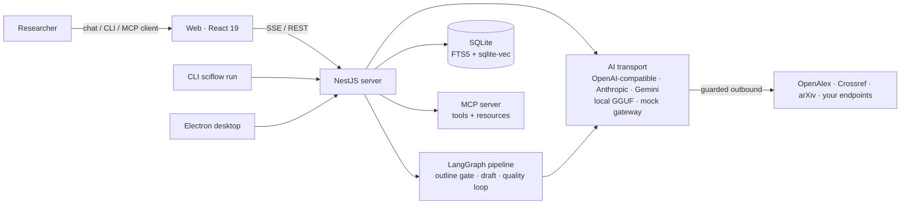

| Package | Stack |
| --- | --- |
| `apps/server` | NestJS 11 · Drizzle · better-sqlite3 (WAL) · Vercel AI SDK v7 · LangGraph · MCP SDK |
| `apps/web` | React 19 · Vite 6 · Tailwind v4 · TanStack Query/Table · Recharts · CodeMirror 6 |
| `apps/desktop` | Electron 41 · embedded server · electron-builder |
| `packages/core` | Quality audit · citation audit · address policy · pipeline step registry |
| `packages/ai` | Transport · model catalog · guarded outbound fetch · fallback chain · mock gateway |
| `packages/db` | Schema · migrations · secret encryption |
| `packages/retrieval` | Vector + full-text retrieval · RRF fusion · MMR · embeddings |

State chain: `Project → Document (versioned) → Citation → Reference`, with `PipelineTask`, `AgentExecution`, `ReflexionLog`, `MemoryLog`, `LlmCallLog` recording state, traces, revision rounds, memory and cost. Deep detail in [`ARCHITECTURE.md`](ARCHITECTURE.md) and the ecosystem audit in [`docs/ECOSYSTEM-AUDIT.md`](docs/ECOSYSTEM-AUDIT.md).

## Documentation

| Document | Contents |
| --- | --- |
| [`ARCHITECTURE.md`](ARCHITECTURE.md) | Module boundaries, data flow, contracts and decision records |
| [`docs/CONFIGURATION.md`](docs/CONFIGURATION.md) | Model, search, auth and CLI configuration by scenario |
| [`docs/OPERATIONS.md`](docs/OPERATIONS.md) | Health probes, backup and restore, failure modes |
| [`docs/deployment.md`](docs/deployment.md) | Docker, desktop packaging and production notes |
| [`docs/development.md`](docs/development.md) | Local development workflow |
| [`docs/BRAND.md`](docs/BRAND.md) | Visual identity and design tokens |
| [`docs/product-roadmap.md`](docs/product-roadmap.md) | Capability matrix and planned work |
| [`CONTRIBUTING.md`](CONTRIBUTING.md) | Branching, commits, review and release flow |
| [`SECURITY.md`](SECURITY.md) | Threat model and disclosure policy |
| [`CHANGELOG.md`](CHANGELOG.md) | Release history |

## Project status

Current release: **1.15.1**. See [`CHANGELOG.md`](CHANGELOG.md) for the full history and [`docs/product-roadmap.md`](docs/product-roadmap.md) for what is next.

Known gaps: real-model end-to-end runs require your own API key; Docker and Playwright suites run in CI but not on every contributor machine; Windows installer builds locally need a C++ toolchain **or** the [`desktop-installer` CI workflow](.github/workflows/desktop-installer.yml) (verified green). Honest-gap tracking lives in [`docs/ECOSYSTEM-AUDIT.md`](docs/ECOSYSTEM-AUDIT.md).

## License

MIT. See [`LICENSE`](LICENSE).
