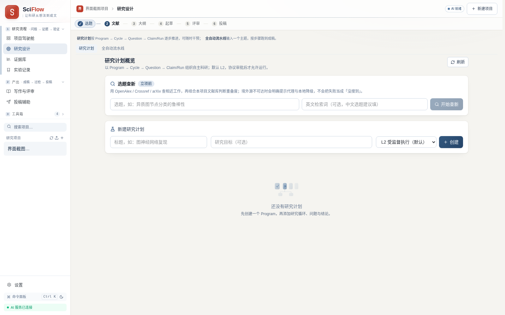
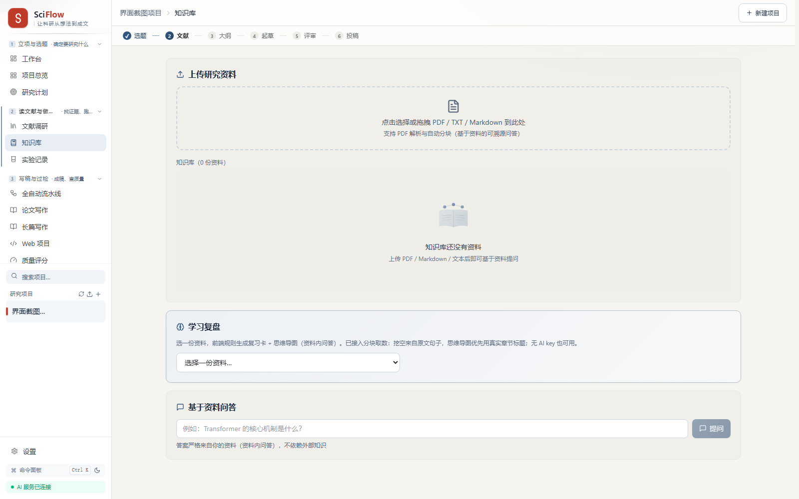
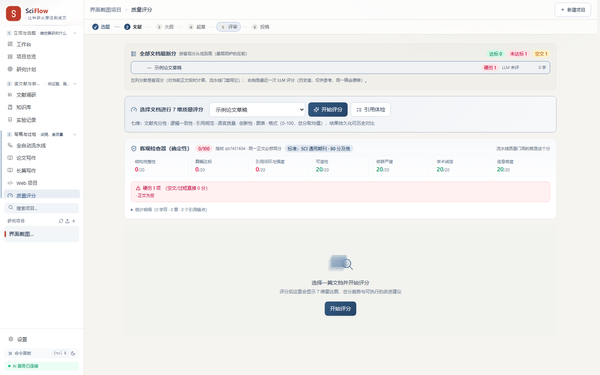
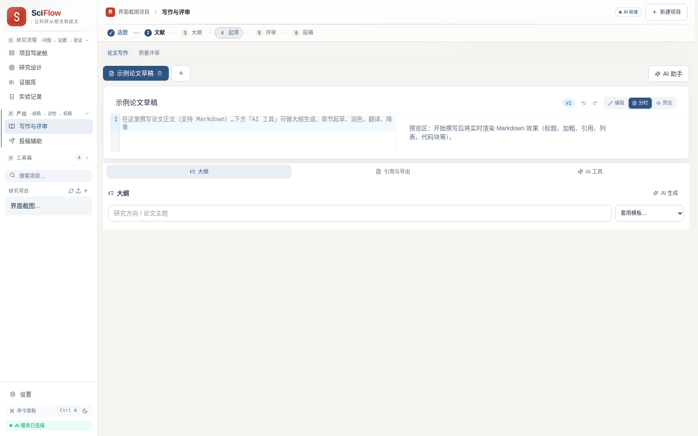
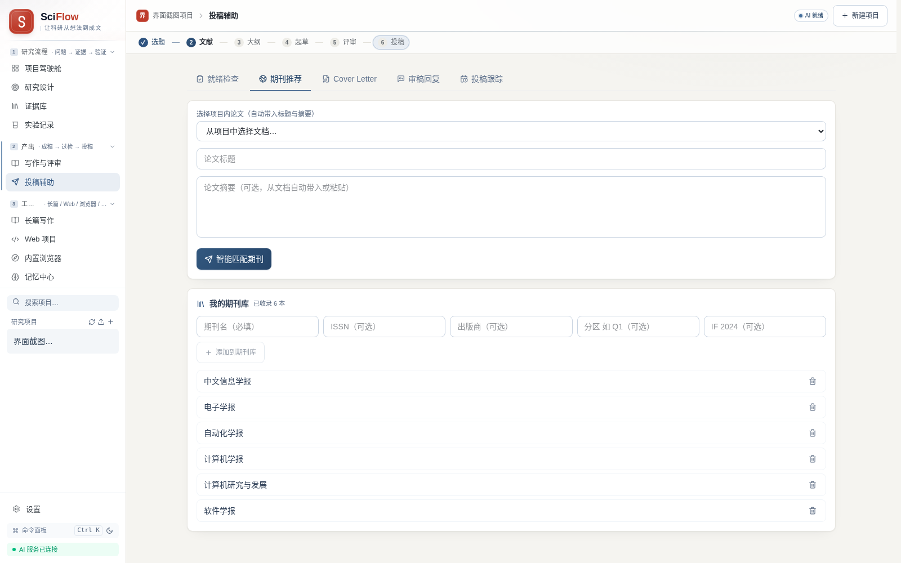
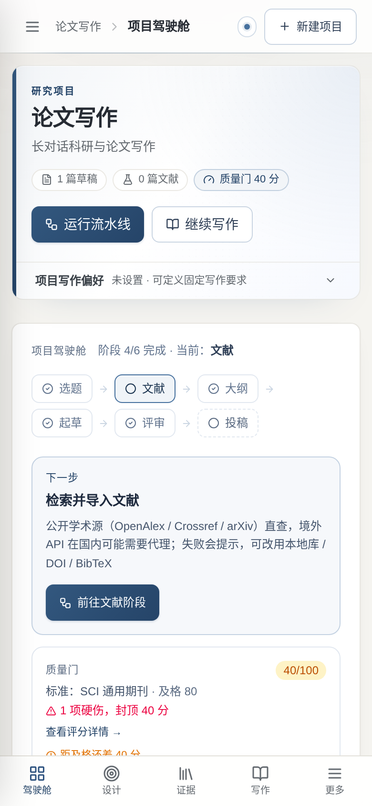

# SciFlow

**本地优先的科研工作台，覆盖文献、写作、评审与投稿；质量由确定性规则把关，引用可以逐层追到底。**

[](https://github.com/badhope/sciflow/actions/workflows/ci.yml)
[](LICENSE)

[English](README.md) · **简体中文**

SciFlow 把整条科研链路留在你自己的电脑上：一个 SQLite 文件、你自己的模型接口、不需要托管账号。它面向想快速干活的研究者，而不是再增加一个要维护的平台。

## 它能做什么

- **带真实证据的研究循环。** PI、实验者、评审和独立复核是彼此分离的 Agent。协议执行前会停下来等人审批，自动模式则由独立专家 Agent 审批。结论必须能对上真实运行里的逐字证据。
- **稿件流水线。** 选题检查、文献调研、大纲门禁、分章起草、质量评审、引用格式化。每步都写检查点，服务重启后可以接着跑。
- **可信的质量门。** 七个维度由规则计分并带稳定指纹。过不过由门禁决定，模型分只作参考；不达标的稿子进入定向修改，而不是重抽一遍。
- **文件与搜索只有一个入口。** 对话附件和知识库共用一套解析：PDF/扫描 OCR、Office、EPUB、图片、音视频。Cmd+K 一次检索文档、会话、项目、实验、文献与知识库。
- **引用能落地。** 正文每个 `[n]` 先指向 citation 行，再指向 reference。幽灵锚点、孤儿条目、断号、重复 DOI 都会被点名。文献库为空时直接禁止引用标记。
- **投稿材料一次备齐。** 就绪检查、期刊模板、Cover Letter、相关图表，最后打成一个确定性投稿包下载。
- **分享、评论与自动化。** 文档和对话可以生成只读快照分享，评论默认关闭；定时/事件任务在新文献入库、流水线完成、质量分低于阈值或实验失败时触发，支持站内、浏览器与飞书通知。
- **手机远程控制。** 桌面端生成一次性二维码/链接，手机扫码后打开完整工作台；后端仍只监听回环，网关只做鉴权与转发，可随时刷新或停止。

## 界面一览

| 科研驾驶舱 | 研究设计与循环 |
| --- | --- |
|  |  |
| **知识与证据** | **确定性质量门** |
|  |  |
| **写作与评审** | **投稿包** |
|  |  |

## 手机远程控制

桌面端点「远程」生成一次性二维码/链接。手机打开的是完整工作台，不是裁剪版：项目、科研对话、写作、流水线、审批和设置都能操作，数据与 Agent 仍留在电脑上。

<p align="center">
  
  &nbsp;&nbsp;
  
</p>

<sub>截图中 <code>sciflow.example.com</code> 是占位公网地址。同一 Wi-Fi 下二维码会自动使用局域网地址；外网访问需设置 <code>SCIFLOW_REMOTE_PUBLIC_URL</code> 并加一层 HTTPS 反向代理。</sub>

## 开始

需要 Node 20+ 与 pnpm。

```bash
git clone https://github.com/badhope/sciflow.git
cd sciflow
pnpm install
cp apps/server/.env.example apps/server/.env   # 填写 AI_BASE_URL、AI_API_KEY、AI_MODEL
pnpm build && pnpm start
```

打开 `http://localhost:3000`。没有模型 Key 也能跑通整条流水线：

```bash
AI_MOCK=1 DATABASE_PATH=/tmp/sciflow_demo.db PORT=3000 \
  node apps/server/dist/apps/server/src/main.js
node scripts/seed-demo.mjs
```

桌面端与 Docker 的构建方式见 [`docs/DESKTOP.zh-CN.md`](docs/DESKTOP.zh-CN.md) 和 [`docs/deployment.zh-CN.md`](docs/deployment.zh-CN.md)。

## 文档

- [`docs/PROJECT-BASELINE.zh-CN.md`](docs/PROJECT-BASELINE.zh-CN.md) — 当前状态、已交付清单、任务池与路线图
- [`docs/COMPETITIVE-ANALYSIS.zh-CN.md`](docs/COMPETITIVE-ANALYSIS.zh-CN.md) — 竞品矩阵、场景边界与可行性
- [`ARCHITECTURE.zh-CN.md`](ARCHITECTURE.zh-CN.md) — 模块边界与数据流
- [`docs/CONFIGURATION.zh-CN.md`](docs/CONFIGURATION.zh-CN.md) — 模型、检索、鉴权与 Agent 配置
- [`docs/OPERATIONS.zh-CN.md`](docs/OPERATIONS.zh-CN.md) — 健康检查、备份与故障处理
- [`docs/README.zh-CN.md`](docs/README.zh-CN.md) — 完整索引，每页都有英文入口
- [`docs/product-roadmap.zh-CN.md`](docs/product-roadmap.zh-CN.md) — 已交付能力与明确不做的事
- [`docs/COLLABORATION-BOUNDARY.zh-CN.md`](docs/COLLABORATION-BOUNDARY.zh-CN.md) — 谁能看、谁能评论、谁能撤销分享
- [`docs/ACCEPTANCE-REPORT.zh-CN.md`](docs/ACCEPTANCE-REPORT.zh-CN.md) — 1.19.17 真实验收证据，包括仍未闭环的边界
- [`CONTRIBUTING.zh-CN.md`](CONTRIBUTING.zh-CN.md) · [`SECURITY.zh-CN.md`](SECURITY.zh-CN.md) · [`CHANGELOG.md`](CHANGELOG.md)

每份指南顶部都有可点击的 `English` 切换。

## 边界

质量门由规则驱动，取向保守。自主运行需要能力足够的模型来扮演 PI 与评审。Python 沙箱是本地运行器，不是对抗恶意代码的安全边界。

## 许可

MIT，见 [`LICENSE`](LICENSE)。
