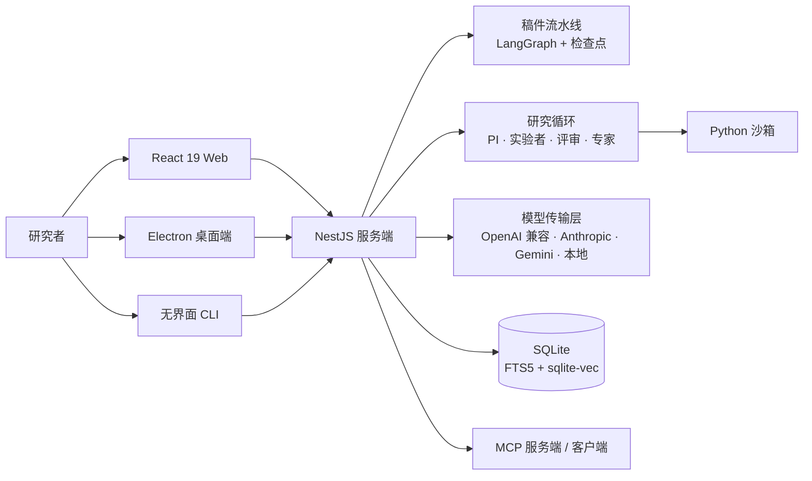

# SciFlow

**本地优先的科研平台：既能跑自主研究循环，也能产出可投稿稿件；过不了确定性检验的成果，不交给用户。**

[](https://github.com/Morningstar202604/sciflow/actions/workflows/ci.yml)
[](LICENSE)
[-339933.svg)](package.json)
[](package.json)
[](CHANGELOG.md)

[English](README.md) · **简体中文**

---

## 核心差异

| | |
|---|---|
| **自主研究循环** | 研究计划 → 循环 → 问题 → 假设 → 协议 → 运行 → 结论 → 证据。PI、实验者、评审、独立专家是四个分离的 LLM 角色；每个协议执行前都要过门禁：人工审批，或全自动模式下由独立 AI 专家审批。 |
| **确定性质量门** | 七个维度由规则计分并带稳定指纹，同一文本必然同分。门禁分是验收标准，LLM 分只作参考；低于阈值触发定向回炉，不靠重抽。 |
| **引用可追溯** | 正文每个 `[n]` 锚点都能追到 citation 行，再追到 reference 行；幽灵锚点、孤儿条目、断号、重复 DOI 按编号报告。文献池为空时，起草直接禁止引用标记。 |
| **证据而非文风** | 结论落库时带 stance、强度与实验 stdout 的逐字引用；评审没有对应的 supports 证据就不能判 supported。 |
| **长篇写作** | 书 → 卷 → 章，逐章生成。每章独立落库、已完成不覆盖、失败可重试；跨章一致性靠压缩摘要传递，因此篇幅不受上下文窗口限制。 |
| **稿件流水线** | 选题验证 → 文献调研 → 大纲门禁 → 分章起草 → 质量门 → 润色 → 引用格式化。每步写检查点，重启可续跑。 |
| **检索有依据** | SQLite FTS5 + sqlite-vec，RRF 融合与 MMR；OpenAlex / Crossref / arXiv 检索带相关性门禁与 TTL 缓存。文献只作为研究循环的背景输入，不作为编造引用的素材。 |
| **开放接入** | MCP 服务端与客户端、OpenAI 兼容 / Anthropic / Gemini 协议、本地 Ollama 或 GGUF、桌面端、无界面 CLI、共享部署用 JWT 模式。 |

## 一次完整产出的实测

2026-11-13 用真实模型跑通：20 篇真实文献 → 10,834 字稿件；18 个引用锚点、18 条 citation 记录、0 个幽灵锚点；客观质量分 97/100。自主研究循环另外产出 1 条 supported 结论，附 5 条来自沙箱实验 stdout 的逐字证据。

## 快速开始

需要 Node ≥ 20（CI 使用 22）与 pnpm 11.7.0。

```bash
git clone https://gitcode.com/badhope/sciflow.git
cd sciflow
pnpm install
pnpm doctor
cp apps/server/.env.example apps/server/.env
# 在 apps/server/.env 填写 AI_BASE_URL、AI_API_KEY、AI_MODEL
pnpm build
pnpm start
```

打开 `http://localhost:3000`。前端开发用 `pnpm dev:web`。

### 没有 API Key 也能跑通

确定性 mock 网关可在本地跑完整条流水线：

```bash
AI_MOCK=1 DATABASE_PATH=/tmp/sciflow_demo.db PORT=3000 \
  node apps/server/dist/apps/server/src/main.js
node scripts/seed-demo.mjs
```

### 桌面端与 Docker

```bash
pnpm build && pnpm icons && pnpm desktop:dev   # Electron
pnpm desktop:dist                              # 安装包输出到 apps/desktop/release/
docker compose up --build                      # 开发
docker compose -f docker-compose.prod.yml up --build
```

## 验证

下表中的每个数字都来自当前代码树上实际执行的命令（2026-11-13）。

| 检查项 | 命令 | 结果 |
|---|---|---|
| 服务端单测/集成 | `pnpm --filter @sciflow/server test` | 86 文件，670 项 |
| 前端单测 | `pnpm --filter @sciflow/web test` | 29 文件，201 项 |
| 桌面端单测 | `pnpm --filter @sciflow/desktop test` | 1 文件，5 项 |
| 类型 / 构建 | `pnpm -r typecheck` · `pnpm -r build` | 通过 |
| 长篇真实生成 | `POST /api/longform/books/:id/write` | 2 章 / 1,254 字 / 摘要衔接 |
| 浏览器 UI 巡检 | `npx playwright test e2e/ui-sweep.spec.ts` | 4 项通过 |
| 设置页交互 | `npx playwright test e2e/settings-interaction.spec.ts` | 2 项通过 |
| 长篇写作 E2E | `npx playwright test e2e/longform.spec.ts` | 1 项通过 |
| AI 权限档 | `pnpm --filter @sciflow/server test -- agent-policy` | 7 项通过 |
| 真实模型稿件产出 | pipeline API，2026-11-13 | 20 篇文献、10,834 字、18 锚点、0 幽灵、客观 97 |
| 真实模型研究循环 | cycle `50a629be` | supported/90，5 条 verified 证据 |

## 架构



| 包 | 技术栈 |
|---|---|
| `apps/server` | NestJS 11 · Drizzle · better-sqlite3（WAL）· AI SDK v7 · LangGraph · MCP SDK |
| `apps/web` | React 19 · Vite 8 · TanStack Query/Table · Recharts · CodeMirror 6 |
| `apps/desktop` | Electron 42 · 内嵌服务端 · electron-builder |
| `packages/core` | 质量审计 · 引用审计 · 地址策略 · 流水线步骤 |
| `packages/ai` | 传输层 · 模型目录 · 受控出站 · 降级链 · mock 网关 |
| `packages/db` | Schema · 迁移 · 密钥加密 |
| `packages/retrieval` | 向量与全文检索 · RRF · MMR · 嵌入 |

沙箱运行时：Python / Node / shell 三种脚本走同一套隔离执行器（超时、内存上限、输出截断）。科研数据链：`ResearchProgram → ResearchCycle → ResearchQuestion → ResearchHypothesis → ResearchProtocol → ResearchRun → ResearchClaim → ResearchEvidence`。稿件链：`Project → Document（多版本）→ Citation → Reference`。

## 配置

配置位于 `apps/server/.env`；设置页提供同样的选项，并带连接测试与模型探测。

| 变量 | 用途 |
|---|---|
| `AI_BASE_URL` · `AI_API_KEY` · `AI_MODEL` | 主模型端点 |
| `AI_PROTOCOL` | `openai-compatible`（默认）、`anthropic`、`gemini` |
| `AI_MODEL_FAST` · `AI_MODEL_STRONG` | 快慢档路由 |
| `AI_RPM_CAP` | 每分钟请求上限 |
| `DATABASE_PATH` | SQLite 文件位置 |
| `AUTH_MODE` | 本地用 `none`，共享部署用 `jwt` |
| `ALLOW_PRIVATE_OUTBOUND` | 放行回环/内网地址，用于本地模型服务 |

按场景的说明见 [`docs/CONFIGURATION.md`](docs/CONFIGURATION.md)。

## 文档

| 文档 | 内容 |
|---|---|
| [`ARCHITECTURE.md`](ARCHITECTURE.md) | 模块边界、数据流、契约 |
| [`docs/CONFIGURATION.md`](docs/CONFIGURATION.md) | 模型、检索、鉴权与 CLI 配置 |
| [`docs/OPERATIONS.md`](docs/OPERATIONS.md) | 健康探针、备份恢复、故障模式 |
| [`docs/deployment.md`](docs/deployment.md) | Docker 与桌面打包 |
| [`SECURITY.md`](SECURITY.md) | 威胁模型与漏洞披露 |
| [`CHANGELOG.md`](CHANGELOG.md) | 版本历史 |

## 项目状态

当前版本：**1.15.3**。自主研究循环与稿件流水线均已实现并有测试覆盖。已知限制：质量门是规则引擎，口径偏保守；自主循环的 PI/评审仍需要能力足够的模型；Python 沙箱是本地执行环境，不构成对恶意代码的安全边界。

## 许可证

MIT，见 [`LICENSE`](LICENSE)。
