# SciFlow

**科研工作台：从研究主题一路做到可投稿的成稿 —— 不过检验不交稿：确定性的质量门、能查到原文的引用、一套你自己就能重跑的验证体系。**

[](https://github.com/Morningstar202604/sciflow/actions/workflows/ci.yml)
[](LICENSE)
[-339933.svg)](package.json)
[](package.json)
[](CHANGELOG.md)

[English](README.en.md) · **简体中文**

---

## 它到底不同在哪

|  |  |
| --- | --- |
| **一条流水线直通投稿** | 选题验证 → 文献调研 → 大纲确认 → 分章起草 → 质量门 → 润色 → 引用格式化 → 期刊投稿跟踪。每步写检查点，重启可续跑 |
| **确定性的质量门，不是感觉打分** | 七个维度按规则计分，同一份文本必然同分、可复现；低于阈值自动定向修订，最多三轮 |
| **引用真的能查到那一篇** | 正文 `[n]` 锚点 → citation 表 → references 表三级追踪；幽灵锚点、孤儿引用、断号、重复 DOI 都定位到具体编号。文献池为空时，起草提示词直接禁用引用标记 |
| **证据链可见** | 写作视图把论证来路画成一条链——研究问题、文献依据、正文锚点、引用记录——并直接标出断在哪里。22 篇文献但正文零锚点，报「2 处断点」，不是绿勾 |
| **有护栏的自主** | 工具审批在副作用操作前暂停并给出人话理由；重复调用护栏防止空转；模型降级链兜住主端点宕机；每次 LLM 调用带成本留痕 |
| **宣称皆可验证** | 下方验证表在你自己机器上可复跑。数字对不上，就是 bug——欢迎提 issue |

## 界面截图

以下截图均取自真实运行的界面与种子演示数据。

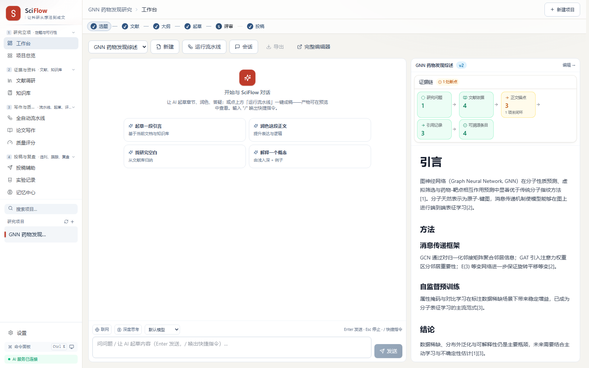

| 项目驾驶舱 | 全自动流水线 |
| --- | --- |
| 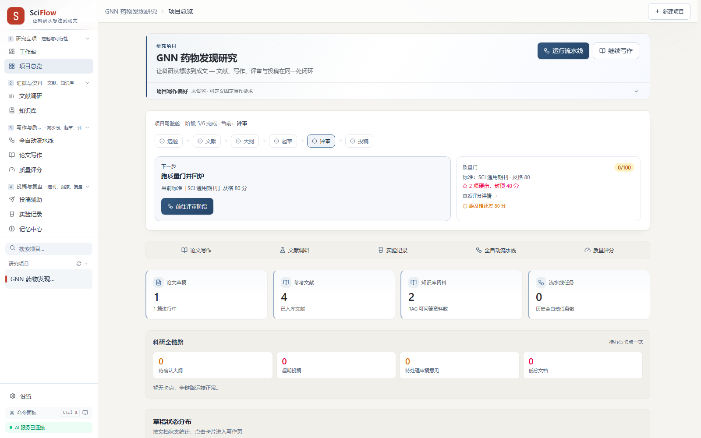 | 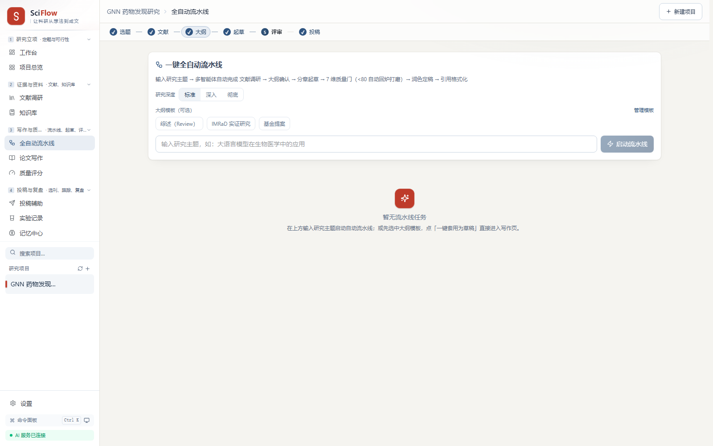 |

| 质量评分：七维打分 | 深色主题（墨夜配色） |
| --- | --- |
| 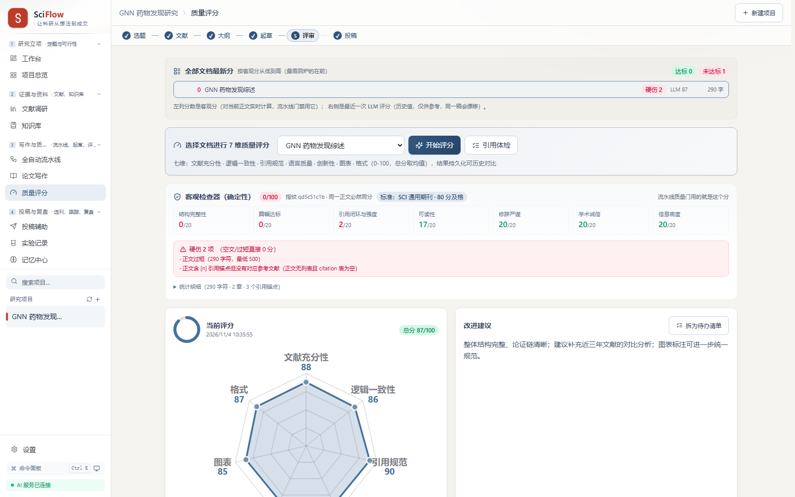 | 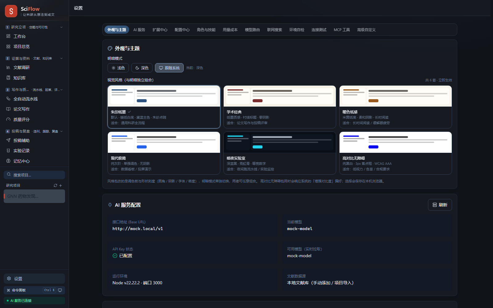 |

| 文献调研 | 知识库：基于资料的问答 |
| --- | --- |
| 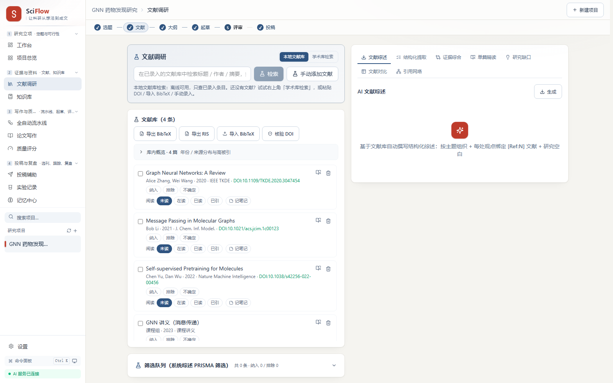 | 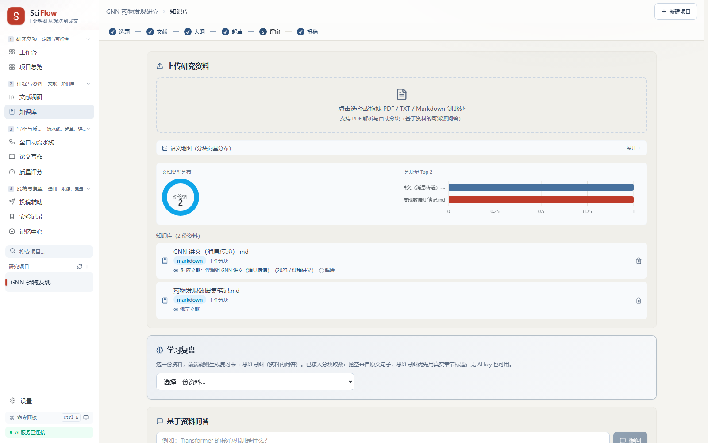 |

| 投稿辅助：选刊、Cover Letter、跟踪 | 实验记录与沙箱 |
| --- | --- |
| 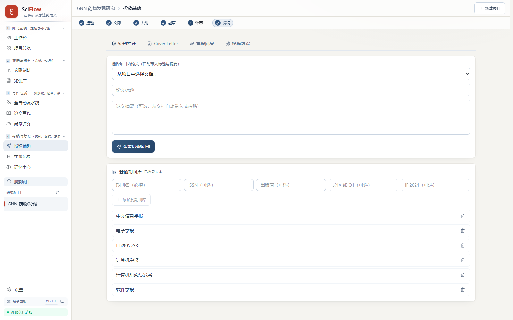 | 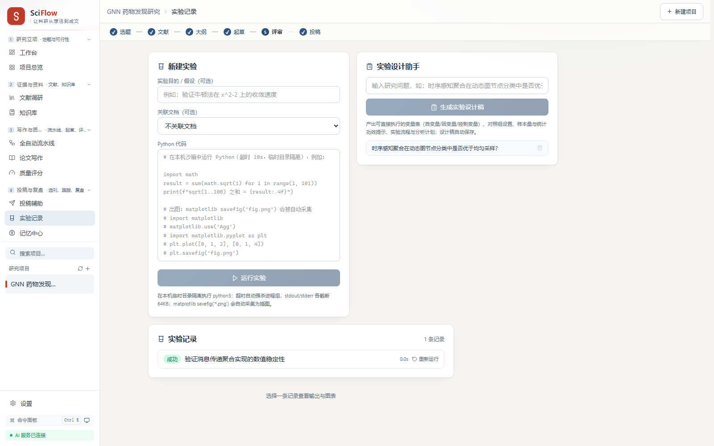 |

| 记忆中心 | 设置：模型、扩展、快捷键 |
| --- | --- |
| 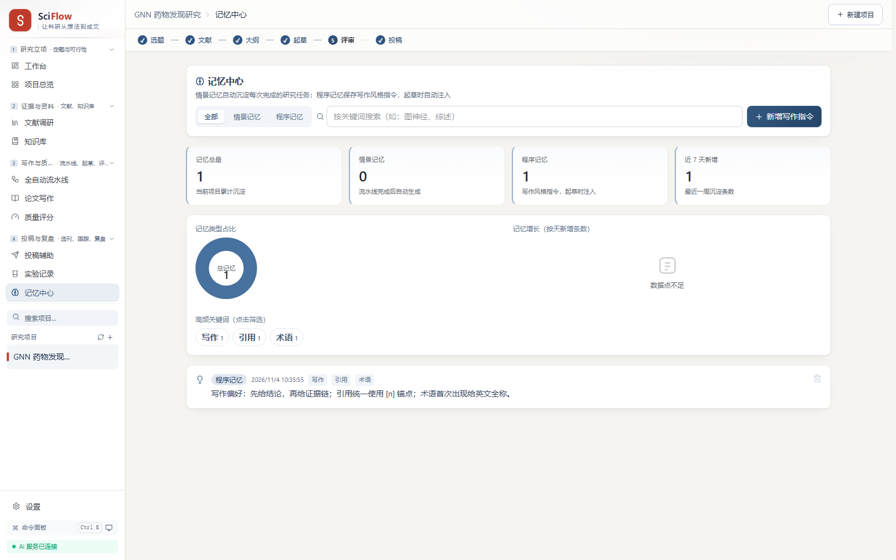 | 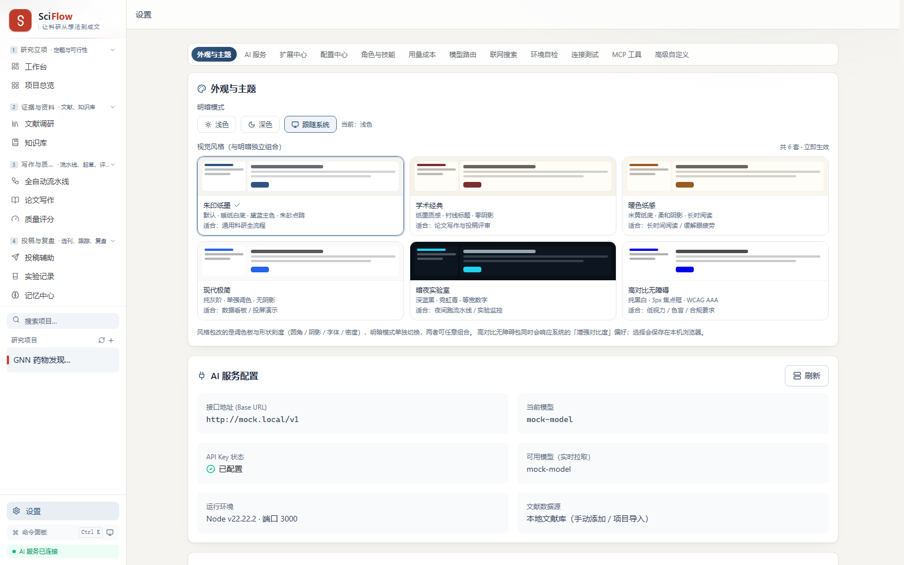 |

## 核心能力

- **科研流水线（LangGraph）**：大纲处保留人工确认，递归文献调研（深度 1–3）、带反共识变体的大纲、并行分章起草、带自动回炉的质量门、润色、引用格式化。
- **确定性质量门**：七个维度全部由规则计算并带稳定指纹（结构、篇幅、引用闭环与强度、可读性、修辞、诚信、信息密度）。五档可选标准从草稿迭代到顶刊投稿，各自约束篇幅、引用数与及格线。正文低于标准下限 90% 直接判硬伤封顶。
- **引用完整性**：锚点 → citation → reference 三级追踪，七类体检。文献池为空时，起草提示词直接禁用引用标记——模型无从编造。
- **Agent harness**：模型维护的任务清单、上下文压缩、`@` 提及、工具审批、重复调用护栏（`AGENT_TOOL_REPEAT_LIMIT`）、模型降级链（`AI_MODEL_FALLBACK`）。
- **检索**：sqlite-vec + FTS5 trigram，RRF 融合、MMR 去冗余；嵌入走本地 GGUF 或厂商接口；学术检索直连 OpenAlex、Crossref、arXiv，带 TTL 缓存。
- **模型自由**：OpenAI 兼容 / Anthropic / Gemini 三种协议，快慢双档路由；本地 Ollama 或本地 GGUF 模型与云厂商端点行为一致。
- **MCP 双向**：把本原能力暴露给任何 MCP 客户端，也能接入外部 MCP 服务器。握手由 [`scripts/mcp-handshake.mjs`](scripts/mcp-handshake.mjs) 持续验证。
- **无界面运行**：`sciflow run --topic "…" --auto --out ./paper/` 不打开窗口也能出稿。

## 快速开始

需要 Node ≥ 20（CI 使用 22）与 pnpm 11.7.0。

```bash
git clone https://gitcode.com/badhope/sciflow.git
cd sciflow
pnpm install
pnpm doctor
cp apps/server/.env.example apps/server/.env
# 在 apps/server/.env 填写 AI_BASE_URL、AI_API_KEY、AI_MODEL
pnpm build
pnpm start
```

打开 `http://localhost:3000`，或用 `pnpm dev:web` 单独启动前端开发服务器。

### 没有 API Key 也能跑通

确定性 mock 网关可在本地跑完整条流水线：

```bash
AI_MOCK=1 DATABASE_PATH=/tmp/sciflow_demo.db PORT=3000 \
  node apps/server/dist/apps/server/src/main.js
node scripts/seed-demo.mjs
```

### Docker

```bash
docker compose up --build                              # 开发
docker compose -f docker-compose.prod.yml up --build    # 生产
```

### 桌面端

```bash
pnpm build && pnpm icons
pnpm desktop:dev     # 开发
pnpm desktop:dist    # 安装包输出到 apps/desktop/release/
```

## 配置

全部配置位于 `apps/server/.env`。设置页提供同样的选项，并带连接测试与模型探测，交互使用时可不必手写该文件。

| 变量 | 用途 |
| --- | --- |
| `AI_BASE_URL` · `AI_API_KEY` · `AI_MODEL` | 主模型端点 |
| `AI_PROTOCOL` | `openai-compatible`（默认）、`anthropic` 或 `gemini` |
| `AI_MODEL_FAST` · `AI_MODEL_STRONG` | 快慢档路由 |
| `AI_RPM_CAP` | 每分钟请求上限 |
| `DATABASE_PATH` | SQLite 文件位置 |
| `AUTH_MODE` | 本地用 `none`，共享部署用 `jwt` |
| `ALLOW_PRIVATE_OUTBOUND` | 放行回环与内网地址，用于本地模型服务 |

按场景的配置说明见 [`docs/CONFIGURATION.md`](docs/CONFIGURATION.md)。

## 验证

下表中的每个数字都来自在当前代码树上实际执行的命令。

| 检查项 | 命令 | 结果（2026-11-04，当前代码树） |
| --- | --- | --- |
| 服务端单测与集成 | `pnpm --filter @sciflow/server test` | 52 文件，404 项 |
| 前端单测 | `pnpm --filter @sciflow/web test` | 25 文件，175 项 |
| 桌面端单测 | `pnpm --filter @sciflow/desktop test` | 1 文件，5 项 |
| 类型 · 规范 · 构建 | `pnpm -r typecheck` · `pnpm lint` · `pnpm -r build` | 通过 · 0 error · 成功 |
| 黑盒回归 | `python scripts/full_regression.py` | 238 通过，0 失败，0 存量缺口 |
| 全路由探针 | `python scripts/route_probe.py` | 96 条路由，0 失败 |
| 验收矩阵 | `python scripts/final_acceptance.py` | 23/23 |
| 配置巡检 | `node scripts/monitor_config_center.mjs` | 25/25 |
| MCP 协议握手 | `node scripts/mcp-handshake.mjs` | 5/5 |

## 架构

```
apps/server      NestJS 11 · Drizzle ORM · better-sqlite3（WAL）· Vercel AI SDK · LangGraph · MCP SDK
apps/web         React 19 · Vite 6 · Tailwind v4 · TanStack Query/Table · Recharts · sigma.js · CodeMirror 6
apps/desktop     Electron 41 · 内嵌服务端 · electron-builder
packages/core    共享领域逻辑：质量审计、引用审计、地址策略、流水线步骤
packages/ai      传输层、模型目录、受控出站请求、mock 网关
packages/db      Schema、迁移、密钥加密
packages/retrieval  向量与全文检索、MMR、嵌入
```

数据链为 `Project → Document（多版本）→ Citation → Reference`，`PipelineTask`、`AgentExecution`、`ReflexionLog`、`MemoryLog`、`LlmCallLog` 记录状态、轨迹、回炉轮次、记忆与成本。

更细的说明见 [`ARCHITECTURE.md`](ARCHITECTURE.md)。

## 文档

| 文档 | 内容 |
| --- | --- |
| [`ARCHITECTURE.md`](ARCHITECTURE.md) | 模块边界、数据流、契约与决策记录 |
| [`docs/CONFIGURATION.md`](docs/CONFIGURATION.md) | 按场景的模型、检索、鉴权与 CLI 配置 |
| [`docs/OPERATIONS.md`](docs/OPERATIONS.md) | 健康探针、备份恢复、故障模式 |
| [`docs/deployment.md`](docs/deployment.md) | Docker、桌面打包与生产部署说明 |
| [`docs/development.md`](docs/development.md) | 本地开发流程 |
| [`docs/BRAND.md`](docs/BRAND.md) | 视觉识别与设计令牌 |
| [`docs/product-roadmap.md`](docs/product-roadmap.md) | 能力矩阵与后续规划 |
| [`CONTRIBUTING.md`](CONTRIBUTING.md) | 分支、提交、评审与发布流程 |
| [`SECURITY.md`](SECURITY.md) | 威胁模型与漏洞披露 |
| [`CHANGELOG.md`](CHANGELOG.md) | 版本历史 |

## 项目状态

当前版本：**1.11.0**。完整历史见 [`CHANGELOG.md`](CHANGELOG.md)，后续规划见 [`docs/product-roadmap.md`](docs/product-roadmap.md)。

已知缺口：真实模型端到端需要你自己的 API Key；Docker 与 Playwright 套件在 CI 中执行，未在每台开发机上验证；Windows 安装包本机构建需要 C++ 工具链，或直接用 [`desktop-installer` CI 工作流](.github/workflows/desktop-installer.yml)（已验证全绿）。诚实的缺口追踪见 [`docs/ECOSYSTEM-AUDIT.md`](docs/ECOSYSTEM-AUDIT.md)。

## 许可证

MIT，见 [`LICENSE`](LICENSE)。
