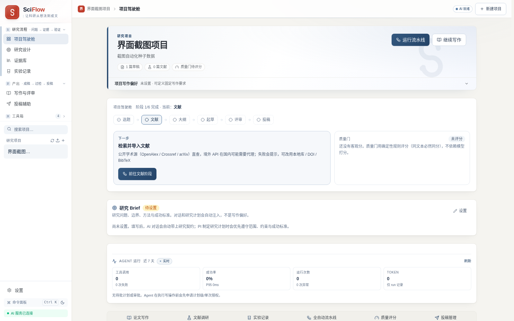

<p align="center">
  
</p>

<p align="center">
  <a href="https://badhope.github.io/sciflow/">官网</a> ·
  <a href="https://github.com/badhope/sciflow/releases/latest/download/SciFlow-Setup-x64.exe">下载 Windows 版</a> ·
  <a href="docs/README.zh-CN.md">文档</a> ·
  <a href="README.md">English</a>
</p>

<p align="center">
  <a href="https://github.com/badhope/sciflow/actions/workflows/ci.yml"></a>
  <a href="https://github.com/badhope/sciflow/releases"></a>
  
  
  <a href="https://github.com/badhope/sciflow/stargazers"></a>
</p>

**前沿 AI 原生科研助手：输入一个研究问题，端到端跑完从协议、实验、评审到投稿包的全链路。**

协议、实验、评审、稿件与投稿包在同一条回路里。模型可以建议，质量门负责说不。

## 科研是一轮回锋

一轮科研不是一次生成。它是一条从研究问题出发、带记忆、带驳回、带证据的端到端回路。


- **有记忆。** 协议、沙箱实验、评审、改写都会落检查点。进程停了，重启后从原处接着跑，不用把整轮重来。
- **有退路。** 评审不通过，稿子不会重抽。它带着具体理由退回协议，只改失败的那一段。
- **有出处。** 正文每个 `[n]` 先落到 citation 行，再落到 reference。幽灵锚点、孤儿条目、断号、重复 DOI，在投稿前就会被点名。
- **有门槛。** 七个维度由确定性规则计分，带稳定指纹。过不过由门禁决定，模型分只作参考。

## 一轮跑完，拿到什么

- **一份能跑的协议。** 研究问题、边界、假设、成功标准、预算与停止条件，在第一轮实验之前就写清楚。
- **一次有证据的实验。** 沙箱执行留下日志与产物。没有运行中的逐字证据，结论就只能是“未支持”。
- **一篇过得了评审的稿件。** 评审与独立审稿人可以带着理由把稿子退回；改写只改失败的那一段，不重抽整篇。
- **一个可交付的投稿包。** 就绪检查、期刊模板、Cover Letter、图表与确定性 ZIP，打包完就能交给期刊。

## 界面



一个项目、六个阶段，引用与门禁状态在同一屏里。写论文，不必再开第二个应用。

## 已经验证的

| 真实模型闭环 | 测试基线 | 桌面发布 |
| :---: | :---: | :---: |
| 连续 2 轮 `supported` | 972 server · 277 web | `v1.19.18` |
| 0 次人工审批 | 237 项回归 | Windows x64 安装包 |

真实模型证据在 [`docs/verification/assets/research-cycle-real-model-2026-11-24.md`](docs/verification/assets/research-cycle-real-model-2026-11-24.md)。安装包与更新清单在同一条 [Release](https://github.com/badhope/sciflow/releases/tag/v1.19.18) 上。

## 开始

需要 Node 20+ 与 pnpm。

```bash
git clone https://github.com/badhope/sciflow.git
cd sciflow
pnpm install
cp apps/server/.env.example apps/server/.env   # 填写 AI_BASE_URL、AI_API_KEY、AI_MODEL
pnpm build && pnpm start
```

打开 `http://localhost:3000`。没有模型 Key，也能先跑通这条回路：

```bash
AI_MOCK=1 DATABASE_PATH=/tmp/sciflow_demo.db PORT=3000 \
  node apps/server/dist/apps/server/src/main.js
node scripts/seed-demo.mjs
```

桌面端与 Docker 的构建方式见 [`docs/DESKTOP.zh-CN.md`](docs/DESKTOP.zh-CN.md) 和 [`docs/deployment.zh-CN.md`](docs/deployment.zh-CN.md)。

## 文档

- [`docs/PROJECT-BASELINE.zh-CN.md`](docs/PROJECT-BASELINE.zh-CN.md) — 当前状态、已交付清单与边界
- [`ARCHITECTURE.zh-CN.md`](ARCHITECTURE.zh-CN.md) — 模块边界与数据流
- [`docs/CONFIGURATION.zh-CN.md`](docs/CONFIGURATION.zh-CN.md) — 模型、检索、鉴权与 Agent 配置
- [`docs/BRAND.zh-CN.md`](docs/BRAND.zh-CN.md) — 标志、色彩与语调
- [`docs/README.zh-CN.md`](docs/README.zh-CN.md) — 完整索引，每页都有英文入口

## 边界

质量门由规则驱动，取向保守。自主运行需要能力足够的模型来扮演 PI 与评审。Python 沙箱是本地运行器，不是对抗恶意代码的安全边界。

## 许可

MIT，见 [`LICENSE`](LICENSE)。

<p align="center">
  <strong>如果这条回路替你省下一次返修，点一个 Star，让下一位研究者也能找到它。</strong><br>
  <a href="https://github.com/badhope/sciflow/stargazers">Star SciFlow</a>
</p>
