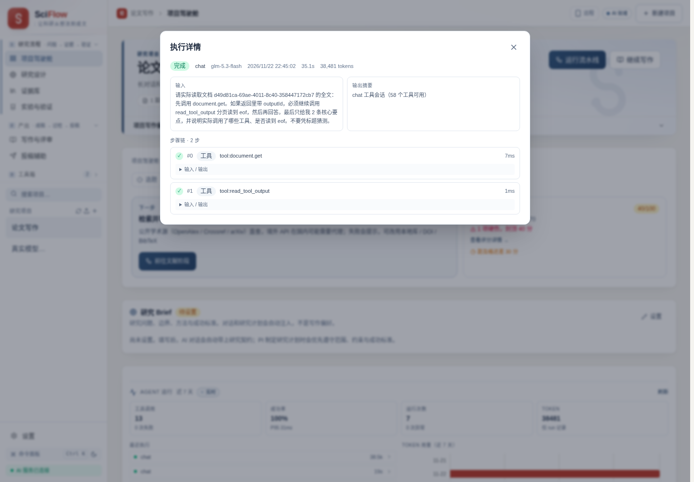
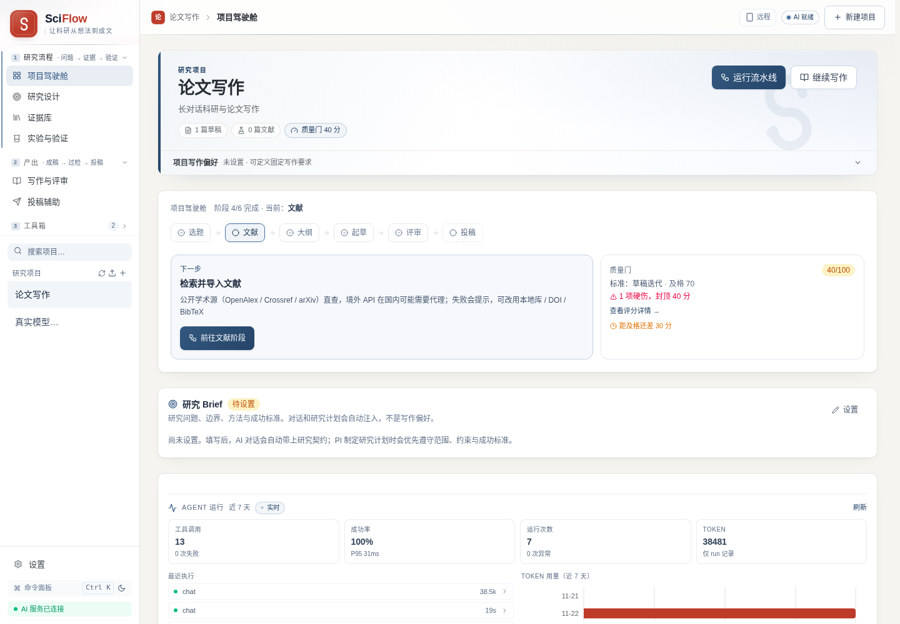

# Agent harness 工程债与真实模型验收（2026-11-22）

**状态：已做完。** 这轮没有新开页面，也没有把 OpenCode 的能力整包照搬；只补了工具循环里真正会影响稳定性、上下文成本和可排查性的缺口，并用真实模型跑通了“超大文档 → 截断落盘 → 分页回读 → 回答”的完整链路。

## 结论

SciFlow 原来的 Agent 基础不差：MCP 工具/资源、审批、计划授权、工具档位、重复调用护栏、动态 `tool_search/tool_invoke`、上下文压缩、轨迹都在。真正欠的是生产细节：大工具输出没有治理、瞬时失败不会重试、取消信号传不下去、并发没有上限、单轮输出没有总预算、成功结果不进轨迹、MCP 没有标准安全注解、流式执行会提前标完成。

这轮把这些补上了，同时复用了已有依赖，没有新造轮子：

- `p-limit` 控制工具并发，`p-retry` 只重试只读工具的瞬时错误。
- `AbortSignal.timeout` + `AbortSignal.any` 做超时与取消，不再维护自建定时器表。
- 官方 MCP SDK 继续作为工具协议唯一出口，`tools/list` 补 `readOnlyHint`、`destructiveHint`、`idempotentHint`、`openWorldHint`。
- 大输出落盘使用系统临时目录，权限 `0600`，24 小时/300 个文件自动清理。

## 这轮落地的细节

| 缺口 | 现在的行为 |
|---|---|
| 超大工具结果原样塞进上下文 | 单结果默认上限 20,000 字，头 70% + 尾 30% 预览；完整内容写入临时文件，模型用 `read_tool_output` 按 `offset/limit` 回读 |
| 回读可以绕开总预算 | `read_tool_output` 也计入 `AGENT_TOOL_OUTPUT_TOTAL_CHARS`，预算不足时返回可读停止原因 |
| 瞬时失败直接失败 | 只读工具 `p-retry` 指数退避 300ms→2s；`document.update` 这类写工具永不自动重试 |
| 模型取消后工具还在跑 | AI SDK 的 `abortSignal` 透传到 MCP 调用；已取消的调用不触达后端 |
| 并行工具无上限 | `AGENT_TOOL_CONCURRENCY` 默认 3 |
| 成功工具输出不进轨迹 | `agent_step.output` 保留 2,000 字成功预览；`read_tool_output`、`tool_search` 也写入轨迹 |
| MCP 客户端分不清只读/破坏性 | 标准 annotations 已下发 |
| SSE 还没读完就标 done | 等上游真正 EOF 才 `finishRun(done)`；异常标 `error`，用户中止标 `cancelled`，驾驶舱显示“已中止” |
| chat run 的 Token 永远是 0 | 流式 usage 回写 `agent_execution.total_tokens`，驾驶舱能看到真实成本 |

审计细节和仍未关闭的债写在 [ECOSYSTEM-AUDIT.zh-CN.md](../ECOSYSTEM-AUDIT.zh-CN.md) 的「2026-11-22 Agent harness 二轮补课」一节。

## 真实模型验证

### 1. 52,642 字符长文，3 页回读

- 模型：`deepseek-v4.1-flash`，真实网关，`AI_MOCK=0`
- 文档：`9802b2a6-2189-40a7-b07b-0edf07f923a7`，正文 16,161 字，工具 JSON 原文 52,642 字符
- 事件链：`document.get` → `read_tool_output(offset=0)` → `read_tool_output(offset=20000)` → `read_tool_output(offset=40000)`
- 返回大小：5,657 / 20,905 / 21,141 / 13,622 字符
- 最后一页 `nextOffset=52642`、`eof=true`
- 该轮暴露了一个真实 bug：SSE 已经发出 `[DONE]`，但 `agent_execution` 被标成 `cancelled`。原因是 forwarder 在 `[DONE]` 处提前 `reader.cancel()`，`trackRunStream` 没等到上游 EOF。修复后重跑，状态改为 `done`。

### 2. 修复后的最终验收

- 模型：`glm-5.3-flash`，真实网关，`AI_MOCK=0`
- 文档：`d49d81ca-69ae-4011-8c40-358447172cb7`，正文 9,071 字
- 执行记录：`e5606f82-d41a-41f6-aabe-86faa76e268a`
- `document.get` 返回 `truncated=true`、`originalChars=9832`
- `read_tool_output` 返回 `eof=true`
- `agent_execution`：`status=done`、`total_tokens=38,481`、`duration_ms=35,072`
- `agent_step`：2 步，`document.get` + `read_tool_output` 都落库
- 模型最终回答明确写出“已读到 eof”，并给出 2 条基于全文的要点，没有靠标题猜





## 门禁

| 项目 | 结果 |
|---|---|
| `pnpm -r typecheck` | 通过（server + web） |
| `pnpm lint` | 通过 |
| Web 单测 | 49 文件 / 264 测试通过 |
| Server + packages 单测 | 124 文件 / 872 测试通过 |
| `pnpm -r build` | 通过（保留 Vite 大 chunk 警告：`WritingEditor`、`elk`） |
| `pnpm openapi:check` | 通过，无契约 diff |
| API 路由探针 | 105/105 通过 |
| JWT 权限验证 | 28/0 通过 |
| `pnpm doctor` | 环境可用；端口 3000 占用、环境变量未配 AI、嵌入模型未配，均为既有提示 |

新增/补测：`agent-tool-harness.spec.ts` 10 条、`agent-run-stream.spec.ts` 3 条、`sse.helper.spec.ts` 3 条、`AgentOpsPanel.test.tsx` 5 条（新增“已中止”展示）。覆盖只读重试、写工具不重试、取消不触达、成功输出入轨迹、截断回读、预算上限、路径穿越、原生工具留痕、`[DONE]` 后等 EOF、`cancelled` 展示、真实 token 记录。

## 仍未做

这轮刻意没有铺开：

1. `packages/db/src/database.ts` 的 `ensureColumn` 迁移账本。这是最大的基础设施债，需要单独做校验和、回滚和升级演练。
2. `task`/subagent、会话级 undo/checkpoint、后台多会话执行器。它们和 OpenCode 有真实差距，但没有产品口径前硬加，UI 解释成本会大于收益。
3. 技能正文按需加载（`skill` 工具），目前仍是系统提示内最多 8,000 字的直接注入。
4. LSP/code diagnostics。SciFlow 是科研工作台，不是纯编程 IDE，是否值得接需要产品取舍。
5. MCP prompts 仍未暴露；tools 和 resources 已暴露。
6. Vite 大 chunk 还没拆。

## 复现入口

```bash
pnpm --filter @sciflow/server exec vitest run src/agent src/chat src/mcp src/common/sse.helper.spec.ts
pnpm --filter @sciflow/web exec vitest run src/pages/dashboard/AgentOpsPanel.test.tsx
pnpm -r typecheck && pnpm lint && pnpm -r build
pnpm test:api
```
