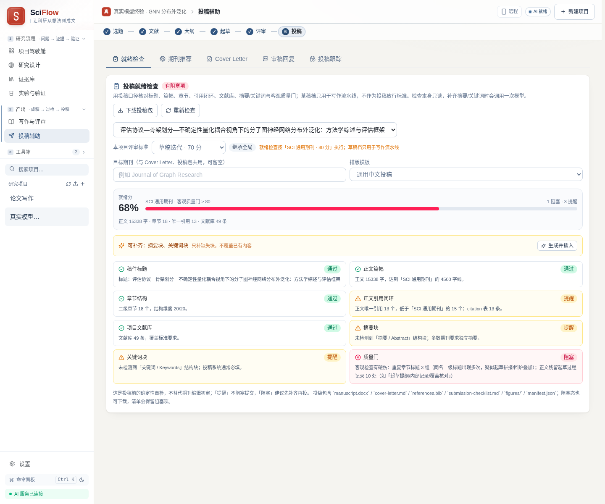

# SciFlow v1.19.15 发布验收

- 日期：2026-11-22
- 版本：`1.19.15`
- 发布类型：PATCH
- 代码提交：`release: v1.19.15`（附注标签 `v1.19.15` 指向该提交）
- 发布范围：GitHub 三仓、GitCode、Gitee

## 这版改了什么

### 投稿就绪检查升级为投稿口径

草稿迭代档只服务写作流水线，不再作为“能不能投”的放行标准。项目仍选草稿档时，readiness 自动按「SCI 通用期刊 · 80 分」执行；会议论文、综述、顶刊标准保持用户选择。

真实项目 `e1139d37-e06c-4b9a-baa2-c11ccc7f842a` 仍配置为草稿档，就绪检查实际返回：

```text
standard: SCI 通用期刊 / 80
score: 68
failCount: 1
warnCount: 3
```

页面同时显示“就绪检查按「SCI 通用期刊 · 80 分」执行；草稿档只用于写作流水线”，避免把 70 分草稿门槛误读成投稿门槛。

### 六项 Agent 应用收口

1. 研究循环审批默认展开待批方案正文，包含目标、变量、样本、分析、执行步骤、风险和参考依据。
2. 工具调用卡显示真实运行状态、耗时、输出、错误和拒绝；旧记录没有结果事件时显示“状态未记录”。
3. Agent 执行历史可点击查看详情，包含模型、Token、耗时、输入/输出和逐步工具链。
4. 计划审批卡展示 `plan.plan` 正文，不再只给摘要和工具白名单。
5. 长篇章节可打开只读正文、复制整章、下载单章 Markdown；连写数量支持 1–50。
6. 投稿 readiness 可补齐缺失的摘要/关键词块，期刊名从选刊同步到登记、Cover Letter 和投稿包。

## 门禁结果

| 项目 | 命令 | 结果 |
| --- | --- | --- |
| 工作区类型检查 | `pnpm -r typecheck` | 通过（server / web） |
| 全量 ESLint | `pnpm lint` | 通过 |
| Web 单测 | `pnpm --filter @sciflow/web test` | 49 files / 263 tests 全通过 |
| Server + packages 单测 | `pnpm --filter @sciflow/server test` | 122 files / 857 tests 全通过 |
| 工作区构建 | `pnpm -r build` | 通过 |
| OpenAPI | `pnpm openapi:gen` | 238 paths，version `1.19.15` |
| 全量回归 | `scripts/full_regression.py` | PASS 238 / FAIL 0 / KNOWN 0 |
| 路由探针 | `scripts/route_probe.py` | 96 / 96 |
| 配置中心巡检 | `scripts/monitor_config_center.mjs` | 24 / 24 |
| JWT 访问控制 | `scripts/verify-jwt-access.mjs` | PASS 28 / FAIL 0 |
| 依赖审计 | `pnpm audit --audit-level high` | No known vulnerabilities |

全量回归第一次跑出 `PASS 237 / FAIL 1`，失败项是旧断言“内置资产默认全启用”。实际目录中 PubMed、Deep Research、Agentset、DocsAgent 四条 MCP 明确标记 `defaultEnabled: false`，因为它们依赖本机 Docker 或医学场景。回归脚本和配置中心巡检已改为校验“按目录默认启用策略”，四个按需关闭、其余全开；重新从空库跑为 `PASS 238 / FAIL 0`。

## 真实界面验收

六项交互的完整点击与取证见 [ux-polish-2026-11-22.md](./ux-polish-2026-11-22.md)。

项目仍使用草稿档时，投稿辅助的就绪检查显示：

- 就绪分 68%
- 1 阻塞、3 提醒
- 标准行：`SCI 通用期刊 · 客观质量门 ≥ 80`
- 提示：`就绪检查按「SCI 通用期刊 · 80 分」执行；草稿档只用于写作流水线`



截图：`docs/screenshots/ux-polish/readiness-standard.png`

前一轮已完成真实点击：

- 摘要/关键词“生成并插入”成功，插入后摘要/关键词由提醒转为通过。
- 《软件学报》从期刊推荐带入投稿跟踪、Cover Letter、就绪检查三处。
- 长篇第 1 章打开 691 字正文，连写数量填 5 后按钮变为“连写 5 章”。
- Agent 执行详情打开 `chat / deepseek-v4.1-flash / 0.2s / 0 tokens / tool:project.list / 6ms`。

## 已知边界

- Web 构建仍有既有大 chunk 警告：`WritingEditor` 624.21KB、`elk` 1,498.94KB；没有新增 chunk budget 断言。
- Web 单测仍会出现 `ECONNREFUSED 127.0.0.1:3000` 的 AggregateError 噪声，来自既有 SSE 连接副作用，不影响全绿。
- 桌面重启后远程控制不自动恢复；公网需 `SCIFLOW_REMOTE_PUBLIC_URL` 与外部 HTTPS 反代；无局域网地址时二维码可能一直“生成中”；远程弹窗仍缺独立前端单测。
- LLM 评审是否纳入质量门禁、研究循环空响应兜底是否算正式产品行为，仍未拍板。
